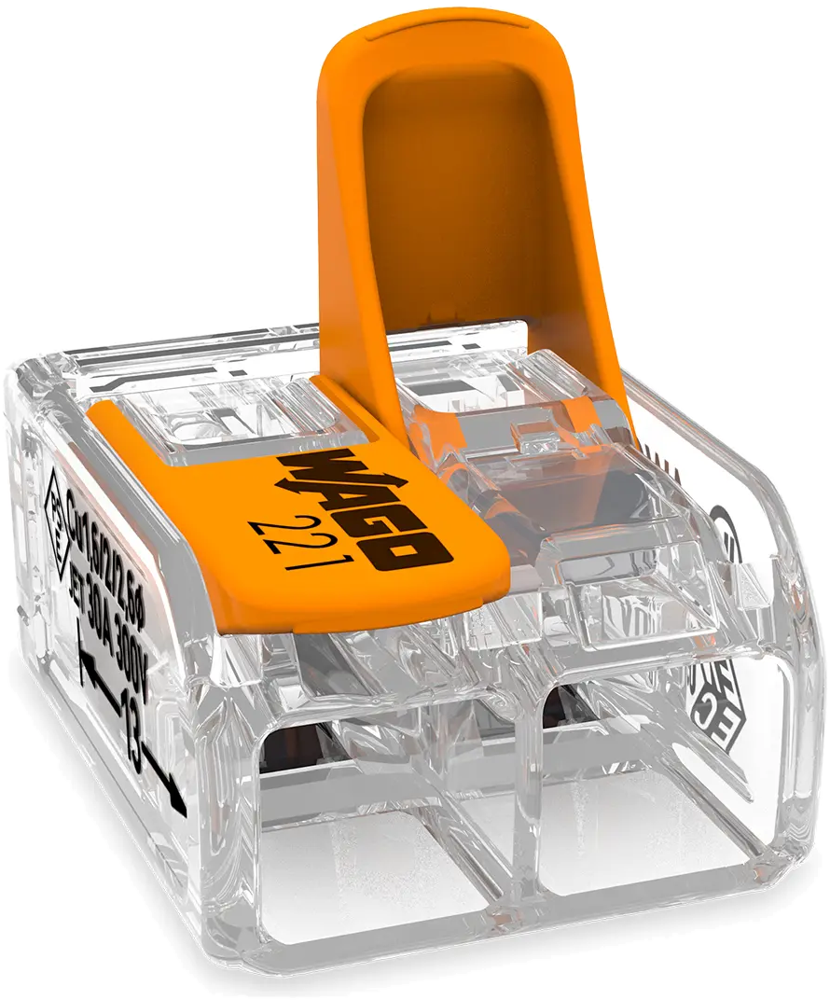
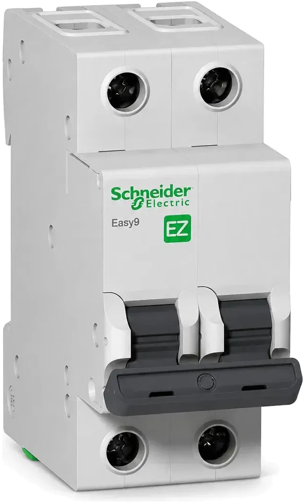

# Ficha de Curadoria (Portão 1) — Ducha Eletrônica Zagonel ND 7700W Branco

## 1. Problema real resolvido

- **Dor cotidiana:** em chuveiros multitemperatura (3 ou 4 estágios), o usuário precisa fechar o registro no inverno até a água perder volume para conseguir esquentar; além disso, chuveiros eletrônicos mal instalados (bitola fina, mau contato ou ligados sem purga de ar) queimam resistência ou placa logo nos primeiros usos.
- **Solução técnica do produto:** controle eletrônico linear contínuo até **7700W (220V)** sem depender de fechar o registro de água, preservando o projeto clássico da linha **ND** (jato concentrado, funcionamento mais silencioso e resistência de encaixe compatível **`TSE0277`**).

## 2. História real de engenharia & marca (2012 → 2024)

1. **1989 — Origem da Zagonel:** fundada em Pinhalzinho (SC), atuando no desenvolvimento nacional de duchas, torneiras elétricas e iluminação.
2. **2012 — Era Thermosystem e entrada da Duratex:** a **Thermosystem** consolidou as linhas eletrônicas **ND** e **Optima** (famosas pelo jato volumoso, ajuste contínuo sem fechar o registro e resistência durável); em **2012**, foi adquirida pela **Duratex** (atual **Dexco**).
3. **Julho de 2015 — Consolidação Hydra Corona:** a Duratex comprou a **Duchas Corona** (por cerca de R$ 116,2 milhões) e passou a comercializar as duchas sob o guarda-chuva **Hydra Corona**, mantendo o molde e o padrão de encaixe da resistência das linhas ND/Optima.
4. **Outubro a Dezembro de 2024 — Compra pela Zagonel e saída da Dexco:** pressionada por margens menores no segmento de chuveiros elétricos (frente à liderança da Lorenzetti e ao avanço do aquecimento a gás), a **Dexco** decidiu sair de duchas e torneiras elétricas — registrando baixa contábil (*impairment*) de ~R$ 100 milhões — e vendeu as marcas **Corona** e **Thermosystem** (fábrica em Aracaju/SE para 12 milhões de peças/ano e CDs em Aracaju e Tubarão/SC) para a **Zagonel**. A operação foi aprovada sem restrições pelo CADE e concluída em **13/12/2024**, consolidando a Zagonel como a 2ª maior fabricante do país. A marca **Hydra** permaneceu com a Dexco (focada em válvulas de descarga e metais, descontinuando chuveiros Hydra).

**Fontes verificadas:**
- [FIESC — Zagonel compra marcas Corona e Thermosystem da Dexco](https://fiesc.com.br/pt-br/imprensa/zagonel-de-pinhalzinho-compra-marcas-corona-e-thermosystem)
- [Dexco — Histórico e aquisição da Duchas Corona](https://www.dex.co/)
- [Exame — Venda de Corona e Thermosystem pela Dexco](https://exame.com/) / [Revista Anamaco — Detalhes da operação](https://revistaanamaco.com.br/)

## 3. Especificações técnicas e consenso de fóruns (Zagonel vs Lorenzetti)

- **Modelo oficial:** Ducha ND — **220V, 7700W** (há versão 127V/5500W na linha), cabo mínimo **6 mm²** e disjuntor dedicado **40 A**. Fonte: [Zagonel Oficial — Ducha ND](https://www.zagonel.com.br/produtos/48).
- **Resistência compatível:** código **`TSE0277`** (`TS` = Thermosystem + `E` = Eletrônica), liga Níquel-Cromo, compatível com duchas eletrônicas ND, Optima e Star (não compatível com modelos multitemperatura mecânicos). Fonte: [Tabela Códigos Zagonel (TSE0277)](https://pratimix.com.br/resistencia-zagonel-ducha-eletronica).
- **Consenso em fóruns de eletricistas (Zagonel vs Lorenzetti):**
  - **Lorenzetti:** lidera em volume e facilidade de encontrar peças/resistência em qualquer bairro (com avanço na linha *Acqua* em cartucho), mas modelos tradicionais recebem críticas por fios mais finos e plásticos que ressecam com os anos.
  - **Zagonel:** elogiada pelo **controle eletrônico suave, funcionamento mais silencioso, acabamento/crivos emborrachados e resistência robusta**; porém, placas eletrônicas originais são menos onipresentes em lojas de bairro que as da Lorenzetti, e a longevidade depende de **instalação rigorosa** (fio 6 mm², conector cerâmico ou Wago adequado, aterramento e **purga de ar com água fria por 30–60s** antes de ligar o disjuntor).
- **Pontos de atenção (auditoria quantitativa em `2026-11-18` no anúncio `MLB47799834`, 2.937 avaliações, média 4,8★):**
  - **Distribuição de estrelas:** **87,88% (5★)** + **6,91% (4★)** = **94,79%** positivas; **3★ (2,25%) + 2★ (0,65%) + 1★ (2,32%) = 5,22%** (~153 avaliações, das quais **87** têm texto escrito).
  - **Recorrência nos 87 textos de 1–3★ (e peso frente ao total):**
    1. *Queima precoce (≤1–2 meses):* 14 menções (~16% dos negativos escritos; **<0,5%** do total) — risco real ligado na bancada a ligar sem purga de ar ou fiação inadequada.
    2. *Jato concentrado / percebido como fraco:* 14 menções — questão de expectativa pelo espalhador compacto.
    3. *Haste sem adesivo colorido de temperatura:* 6 menções em 1–3★ + citado em avaliações **5★** mais úteis — **mudança real de projeto** da Zagonel em relação à antiga Hydra ND.
    4. *Falha no potenciômetro:* 6 menções (~0,2% do total) — baixa recorrência.
    5. *Vazamento / desvio do chuveirinho:* 5 menções (<0,2% do total) — casos pontuais, não crônicos.

## 4. Confronto entre marketplaces e link principal (Fase 1)

- **Mercado Livre (vencedor — link principal):** [Ducha Eletrônica Zagonel ND 7700W Branco (`MLB47799834`)](https://www.mercadolivre.com.br/ducha-eletronica-zagonel-nd-7700w-branco/p/MLB47799834) — **R$ 138,00** (`220V` selecionada), **Loja Oficial WIRH** (+100 mil vendas), **Full**, **4,8★ (2.937 opiniões)**, `+10 mil vendidos`, comissão ativa de **12%** na barra de afiliados (~R$ 16,56/venda). *(Comparável legado: `MLB19754419` Hydra Zagonel ND a R$ 129,87, 4,7★; descartado `MLB59874712` por ser modelo de 3 temperaturas, não eletrônico.)*
- **Amazon Brasil (referência comparável):** [Zagonel Ducha Eletrônica ND 7700W 220V (`B0F32VD9HN`)](https://www.amazon.com.br/dp/B0F32VD9HN) — **R$ 131,12**, **Prime** (enviado pela Amazon, vendido por Metal Haus), **4,4★ (103 avaliações)**, comissão tabela Casa/Ferramentas de **8%** (~R$ 10,49/venda).
- **Decisão da ficha:** eleger o **Mercado Livre (`MLB47799834`)** como link principal pela maior prova social (2.937 avaliações 4,8★), Loja Oficial + Full e maior comissão (12% vs 8%). *(Gerar o link curto final de afiliado na barra do anúncio no Portão 4.)*

## 5. Ângulo editorial proposto

- **Linha central ("A História que Ninguém Conta + Engenharia Real"):** partir da dúvida real de quem conheceu a **Thermosystem em 2012**, explicar a passagem por **Duratex / Hydra Corona (2015)** até a compra pela **Zagonel (dez/2024)** — mostrando que o mesmo projeto e a resistência **`TSE0277`** sobreviveram –, contrastar com o critério técnico de fóruns (por que não basta olhar ranking de marca mais vendida) e fechar com os cuidados reais de instalação (6 mm², disjuntor 40A, conector e purga fria).
- **Elegibilidade para Mercado Livre Clips:** **sim, se incluir trecho real do produto** e **sem citar preço variável** no áudio.

## 6. Referências audiovisuais do produto

### As 3 eras do mesmo projeto (Thermosystem → Hydra ND → Zagonel ND)

| 2012 · Thermosystem ND | Hydra ND (Dexco/Corona) | Zagonel ND 7700W (Atual) |
|---|---|---|
|  |  |  |

### Componentes de manutenção e instalação

| Resistência `TSE0277` | Conector Wago 41A | Disjuntor 40A |
|---|---|---|
|  |  |  |
