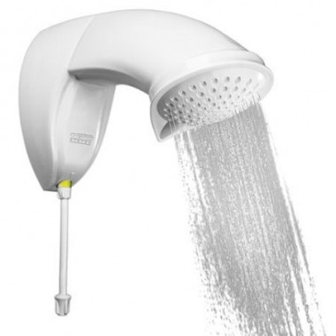
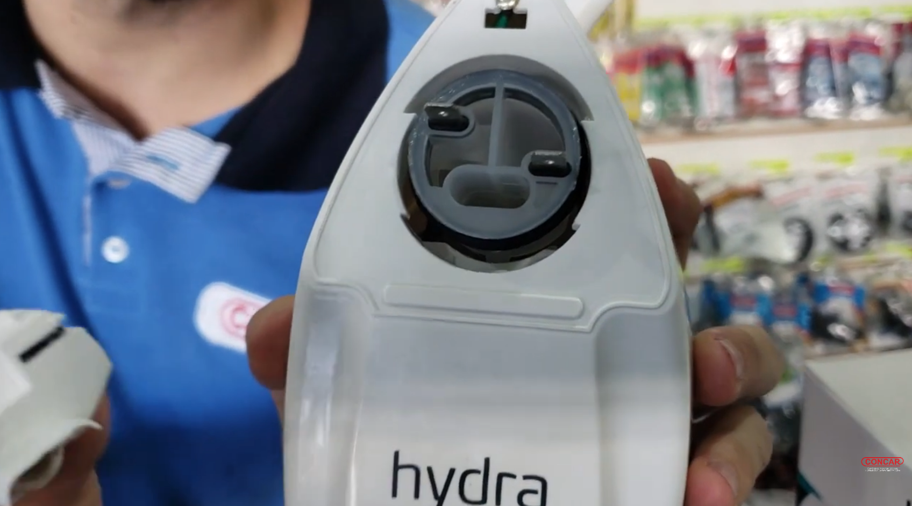
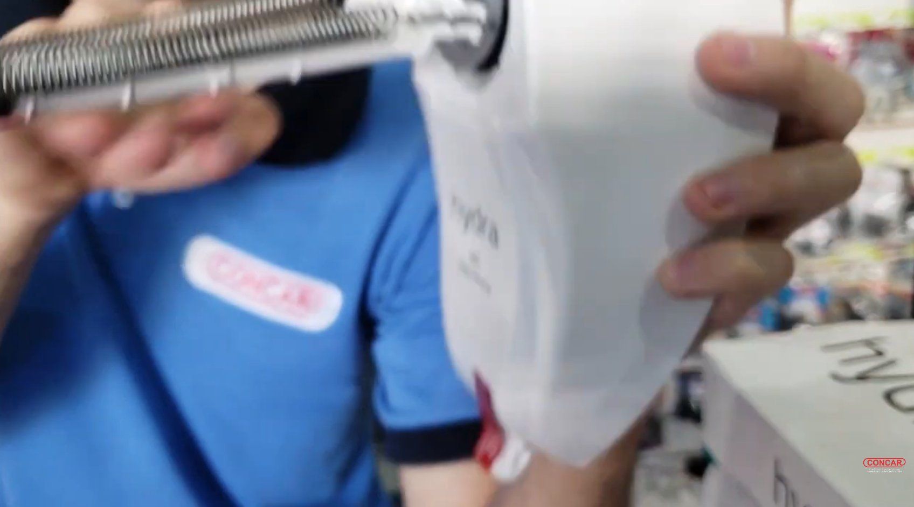
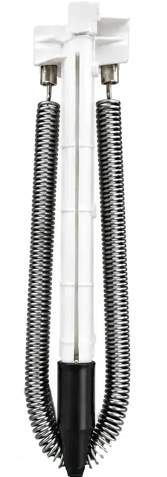

# Ficha de Curadoria (Portão 1) — Ducha Eletrônica Zagonel ND Branco (127V / 5500W e 220V / 7700W)

## 1. Problema real resolvido

- **Dor cotidiana:** em chuveiros multitemperatura (3 ou 4 estágios), o usuário precisa fechar o registro no inverno até a água perder volume para conseguir esquentar; na versão eletrônica, além de comparar potência e instalação elétrica correta para **127V** e **220V**, compradores vindos da antiga **Thermosystem / Hydra ND** buscam saber se o projeto original e o encaixe da resistência permaneceram compatíveis na transição de marca.
- **Solução técnica do produto:** controle eletrônico linear contínuo disponível em **127V (5500W)** e **220V (7700W)** sem depender de fechar o registro de água, preservando o projeto clássico da linha **ND** (espalhador compacto de jato concentrado, funcionamento mais silencioso e câmara com encaixe padrão de resistência da linha ND).

## 2. História real de engenharia & marca (2012 → 2024)

1. **1989 — Origem da Zagonel:** fundada em Pinhalzinho (SC), atuando no desenvolvimento nacional de duchas, torneiras elétricas e iluminação.
2. **2012 — Era Thermosystem e entrada da Duratex:** a **Thermosystem** consolidou as linhas eletrônicas **ND** e **Optima** (famosas pelo ajuste contínuo sem fechar o registro e padrão próprio de encaixe); em **2012**, foi adquirida pela **Duratex** (atual **Dexco**).
3. **Julho de 2015 — Consolidação Hydra Corona:** a Duratex comprou a **Duchas Corona** (por cerca de R$ 116,2 milhões) e passou a comercializar as duchas sob o guarda-chuva **Hydra Corona**, mantendo o molde e o padrão de encaixe da resistência das linhas ND/Optima.
4. **Outubro a Dezembro de 2024 — Compra pela Zagonel e saída da Dexco:** pressionada por margens menores no segmento de chuveiros elétricos (frente à liderança da Lorenzetti e ao avanço do aquecimento a gás), a **Dexco** decidiu sair de duchas e torneiras elétricas — registrando baixa contábil (*impairment*) de ~R$ 100 milhões — e vendeu as marcas **Corona** e **Thermosystem** (fábrica em Aracaju/SE para 12 milhões de peças/ano e CDs em Aracaju e Tubarão/SC) para a **Zagonel**. A operação foi aprovada sem restrições pelo CADE e concluída em **13/12/2024**, consolidando a Zagonel como a 2ª maior fabricante do país. A marca **Hydra** permaneceu com a Dexco (focada em válvulas de descarga e metais, descontinuando chuveiros Hydra).

**Fontes verificadas:**
- [FIESC — Zagonel compra marcas Corona e Thermosystem da Dexco](https://fiesc.com.br/pt-br/imprensa/zagonel-de-pinhalzinho-compra-marcas-corona-e-thermosystem)
- [Dexco — Histórico e aquisição da Duchas Corona](https://www.dex.co/)
- [Exame — Venda de Corona e Thermosystem pela Dexco](https://exame.com/) / [Revista Anamaco — Detalhes da operação](https://revistaanamaco.com.br/)

## 3. Especificações técnicas e consenso de fóruns (Zagonel vs Lorenzetti)

- **Modelos oficiais da linha Zagonel Ducha ND Branco:**
  - **Versão 127V (5500W):** cabo mínimo **10 mm²** (até 30 m do quadro), disjuntor dedicado **50 A**; resistência original Zagonel ref. **`9405000162`** (código compatível paralelo de mercado **`TSE0155`** para 127V/5500W ND/Optima).
  - **Versão 220V (7700W):** cabo mínimo **6 mm²** (até 30 m do quadro), disjuntor dedicado **40 A**; resistência compatível de mercado **`TSE0277`** (liga Níquel-Cromo, linha eletrônica ND/Optima/Star).
  - **Requisitos comuns do manual (ambas as voltagens):** aterramento obrigatório conforme **NBR 5410**, recomendação de dispositivo **DR**, uso de conectores elétricos adequados à corrente nominal e **purga de ar com água fria por alguns segundos/até encher totalmente a câmara** antes de ligar o disjuntor pela primeira vez ou após troca de resistência. Fontes: [Zagonel Oficial — Ducha ND](https://www.zagonel.com.br/produtos/48) e orientações padrão dos manuais da linha ND.
- **Consenso em fóruns de eletricistas (Zagonel vs Lorenzetti):**
  - **Lorenzetti:** lidera em volume e facilidade de encontrar peças/resistência em qualquer bairro (com avanço na linha *Acqua* em cartucho), mas modelos tradicionais recebem críticas por fios mais finos e plásticos que ressecam com os anos.
  - **Zagonel:** elogiada pelo **controle eletrônico suave, funcionamento mais silencioso, acabamento/crivos emborrachados e resistência durável**; porém, placas eletrônicas originais são menos onipresentes em lojas de bairro que as da Lorenzetti.
- **Pontos de atenção (auditoria quantitativa atualizada em `2026-11-19` no catálogo unificado ML `MLB47799833` [cobre `127V` e `220V`] — 2.965 avaliações, média 4,8★, cruzado com `MLB5751826566` [127V, 469 aval., 4,6★] e Amazon `B0F32SH8RN` [127V, 10 aval., 4,4★]):**
  - **Distribuição de estrelas (`MLB47799833`):** **87,96% (5★)** + **6,88% (4★)** = **94,84%** positivas; **3★ (2,23%) + 2★ (0,64%) + 1★ (2,29%) = 5,16%** *(soma exata de 100,00% sobre 2.965 avaliações; ~153 avaliações negativas/neutras de 1–3★)*.
  - **Padrões reais nos comentários de 1★ a 3★:**
    1. *Defeito inicial ou queima precoce (10 dias a 2 meses):* padrão nº 1 entre as avaliações de 1★ e 2★ em ambas as voltagens, com relatos recentes. **Observação factual:** pelos comentários dos compradores não é possível verificar em quantos casos houve falha do produto versus erro de instalação elétrica ou hidráulica.
    2. *Haste sem adesivo colorido de temperatura:* mudança real de projeto da Zagonel em relação à antiga Hydra ND — citada em comentários 1★, 3★, 5★ no ML e no review 2★ da Amazon `127V`, dificultando enxergar a posição de temperatura durante o banho.
    3. *Aquecimento percebido como inferior em `127V / 5500W` e jato concentrado:* reclamação recorrente em `127V` (especialmente em dias frios, exigindo reduzir vazão) e percepção de jato fraco pelo espalhador compacto.
    4. *Acabamento, chuveirinho e potenciômetro:* relatos pontuais de plástico percebido como mais frágil que a antiga Hydra, vazamento/desvio incompleto no chuveirinho, falta de fita no suporte da duchinha e falha pontual no seletor/potenciômetro.

## 4. Confronto entre marketplaces e links principais (Fase 1 — 127V e 220V)

> **Como funcionam os links das duas voltagens (`127V` e `220V`):** no Mercado Livre, a página traz seletor `127V / 220V`, mas **mudar a voltagem troca o ID/URL de catálogo** (`MLB47884399` ↔ `MLB47799834`). Na Amazon, são dois ASINs totalmente separados sem seletor. Portanto, a vitrine e a resposta automática de DM atenderão **ambas as voltagens com dois links diretos**.

- **Mercado Livre (vencedor — links principais, ambos verificados em `2026-11-19` com `GANHOS 12%` ativo na barra de Afiliados):**
  - **Link `220V (7700W)`:** [Ducha Eletrônica Zagonel ND 7700W Branco (`MLB47799834`)](https://www.mercadolivre.com.br/ducha-eletronica-zagonel-nd-7700w-branco/p/MLB47799834) — **R$ 120,00** à vista / oferta vigente, **Full**, vendedor `compraakisp` (`MercadoLíder Platinum`, `+50 mil vendas`), **4,8★ (2.965 opiniões)**, `+10 mil vendidos`, comissão ativa de **`GANHOS 12%`**. *(Observação: o catálogo do ML exibe o valor anômalo `7.7 W` no seletor de potência de `MLB47799834`, apesar do título oficial `7700W`.)*
  - **Link `127V (5500W)`:** [Ducha Chuveiro ND Eletrônica Branco 5500W Zagonel (`MLB47884399`)](https://www.mercadolivre.com.br/ducha-chuveiro-nd-eletronica-branco-5500w-zagonel/p/MLB47884399?product_trigger_id=MLB47884399&attributes=POWER%3A5.5%20kW%2CCOLOR%3ABranco%2CVOLTAGE%3AMLB47884399&picker=true) — **R$ 164,69**, **Loja Oficial `MINAS VALE ATACADISTA`** (`MercadoLíder Platinum`, `+100 mil vendas`; há também oferta **Full** disponível na lista `/s` por R$ 171,00), mesmo pool **4,8★ (2.965 opiniões)**, `+1.000 vendidos`, comissão ativa de **`GANHOS 12%`** com `127V` selecionado. *(Descartado modelo multitemperatura de 3 temperaturas; alternativa complementar Full `MLB5751826566` também exibe `GANHOS 12%`, porém traz texto de descrição trocado de 7700W/220V.)*
- **Amazon Brasil (referências comparáveis — comissão SiteStripe não validada na sessão logada; tabela pública Casa/Ferramentas 8%):**
  - `220V (7700W)`: [Zagonel Ducha Eletrônica ND 7700W 220V (`B0F32VD9HN`)](https://www.amazon.com.br/dp/B0F32VD9HN) — **R$ 131,12**, **Prime** (`Enviado por Amazon`, `Metal Haus`), **4,4★ (103 avaliações)**.
  - `127V (5500W)`: [Ducha Eletrônica ND Zagonel Branca 5500W 127V (`B0F32SH8RN`)](https://www.amazon.com.br/dp/B0F32SH8RN) — **R$ 131,95**, **Prime** (`Enviado pela Amazon`, `Hidrauclick`), **4,4★ (10 avaliações)**.
- **Decisão da ficha:** eleger o **Mercado Livre** com os dois links diretos (`MLB47884399` para `127V` e `MLB47799834` para `220V`) pela comissão confirmada de **`GANHOS 12%`** nos dois anúncios, prova social consolidada (`2.965` opiniões, `4,8★`) e disponibilidade em Loja Oficial / Full. *(Gerar os dois links curtos finais de afiliado no Portão 4.)*

## 5. Ângulo editorial proposto

- **Linha central ("A História que Ninguém Conta + Instalação Honesta para 127V e 220V"):** partir da história real de quem conheceu a **Thermosystem em 2012**, explicar a passagem por **Hydra (2015)** até a compra pela **Zagonel (2024)** mostrando que o projeto e o encaixe da linha ND seguem os mesmos — mas **alertando com transparência** para a mudança real do botão branco sem adesivo colorido de temperatura e reforçando as duas regras do manual que o usuário precisa cumprir na instalação (purgar a câmara com água fria antes de ligar e usar cabo/disjuntor corretos para `127V` ou `220V`), sem atribuir causas não verificáveis às falhas relatadas.
- **Elegibilidade para Mercado Livre Clips:** **pendente de trecho em filmagem real** (sem citar preço variável no áudio).

## 6. Referências audiovisuais do produto

> **Nota sobre ativos (`REQ-003`):** mantêm-se apenas referências reais do produto anunciado e peças/câmara da própria linha ND, sem imagens de marcas terceiras estranhas à venda.

### As 3 eras do mesmo projeto (Thermosystem → Hydra ND → Zagonel ND)

| 2012 · Thermosystem ND | Hydra ND (Dexco/Corona) | Zagonel ND Branco (Atual) |
|---|---|---|
|  |  |  |

### Câmara interna de aquecimento e resistência compatível da linha ND (`REQ-001`)

> Chassi interno com encaixe por baioneta preservado intacto da linha ND (`Thermosystem` → `Hydra` → `Zagonel`) e imagem isolada sem logotipo da resistência compatível, servindo de âncora fiel para a composição determinística na Cena 03 (`REQ-015`).

| Câmara aberta com contatos elétricos | Inserção real da resistência na câmara ND | Elemento de resistência ND (sem marca) |
|---|---|---|
|  |  |  |
