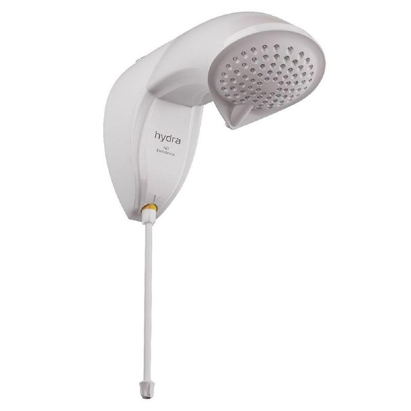
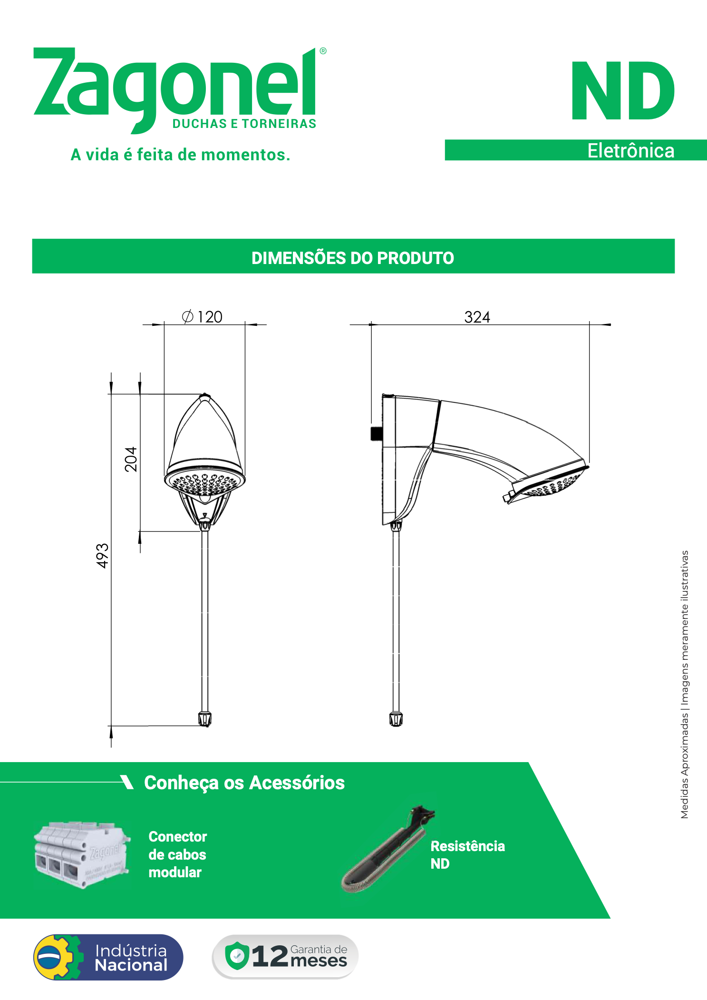

# Ficha de Curadoria (Portão 1) — Ducha Eletrônica Zagonel ND Branco (127V / 5500W e 220V / 7700W)

> **Data da revisão crítica:** `2026-11-20` (Portão 1 — revisão completa após verificação direta em fontes institucionais, PDF oficial da Zagonel, páginas públicas dos marketplaces e extração integral de amostra `1★–3★`).

## 1. Problema real resolvido

- **Dor cotidiana e limitação eletromecânica clássica:** em chuveiros multitemperatura convencionais (3 ou 4 estágios), a mudança de temperatura depende de comutação mecânica de derivações da resistência sob corrente elevada (`30 A` a `45 A`), o que exige desligar o registro ou fechar a vazão no inverno até reduzir drasticamente o jato para a água aquecer, além de expor os contatos seletivos a arco elétrico e desgaste prematuro. Já compradores que procuram a clássica **ND** (conhecida desde a era **Thermosystem** e depois **Hydra Corona**) precisam confirmar se a engenharia interna, as exigências de instalação (`127V / 5500W` vs `220V / 7700W`) e o encaixe rápido da resistência permaneceram compatíveis após a compra da operação pela **Zagonel**, além de saber de antemão o que mudou no acabamento atual.
- **Solução técnica do produto (Estado Sólido `TRIAC` + Acionamento Hidromecânico por Diafragma):** controle eletrônico linear contínuo por ângulo de fase em estado sólido (**`TRIAC`** comandado por potenciômetro na haste prolongada de `493 mm` de altura total), combinado ao acionamento principal hidromecânico por **diafragma** na câmara de aquecimento de **`700 ml`**. Disponível em **`127V` (`5.500 W`, código `DNDEL55127BR03`, `43,30 A`)** e **`220V` (`7.700 W`, código `DNDEL77220BR03`, `35 A`)**, permite regular a potência gradualmente com o registro 100% aberto, aciona com baixa pressão a partir de **`10 kPa` (`1 m.c.a.`)**, possui grau de proteção **`IP 24`**, compatibilidade com dispositivo **DR** e aquecimento solar/a gás, mantendo o espalhador compacto (`Ø 120 mm`, `78 furos / Ø 0,7 mm`) e o formato tradicional da resistência espiral ND de troca facilitada.

## 2. História real de engenharia & marca (1989 → 2024)

1. **1989 — Origem da Zagonel:** fundada em Pinhalzinho (SC), atuando no desenvolvimento nacional de duchas, torneiras elétricas e iluminação, e pioneira no lançamento de ducha eletrônica com regulagem à distância no Brasil.
2. **Setembro de 2012 — Compra da Thermosystem pela Duratex (`R$ 63 milhões`):** em setembro de 2012, a **Duratex** (atual **Dexco**) anunciou a aquisição da fabricante catarinense de chuveiros eletrônicos e aquecedores solares **Thermosystem** (sediada em Tubarão/SC, criadora das linhas eletrônicas **ND** e **Optima**), por cerca de **R$ 63 milhões**, ingressando no setor de duchas elétricas.
3. **Julho de 2015 — Compra da Duchas Corona pela Duratex (`R$ 116 milhões`):** em 1º de julho de 2015, após aprovação do CADE, a Duratex concluiu a compra da **Duchas Corona Ltda.** por **R$ 116 milhões** (valor ajustado acima dos R$ 88,5 milhões iniciais pela inclusão do imóvel de Guarulhos), assumindo a vice-liderança nacional e consolidando as linhas sob o guarda-chuva **Hydra Corona**, mantendo o projeto da linha **ND**.
4. **Outubro a Dezembro de 2024 — Compra das marcas Corona e Thermosystem pela Zagonel:** em **02/10/2024** (após anúncio inicial em 29/08/2024), a **Dexco** anunciou a venda da subsidiária *Dexco Hydra Corona Sistemas de Aquecimento de Água Ltda.* para a **Zagonel**, estimando impacto contábil (*impairment*) de cerca de **R$ 100 milhões** sem efeito caixa. O negócio envolveu as marcas **Corona** e **Thermosystem**, uma fábrica em Aracaju (SE) com capacidade aproximada de **12 milhões de peças/ano** e dois centros de distribuição (Aracaju/SE e Tubarão/SC). A marca **Hydra** permaneceu com a Dexco. Após aprovação sem restrições pelo **CADE**, a operação foi concluída em **13/12/2024**, consolidando a Zagonel como a 2ª maior fabricante do país e mantendo a **Ducha ND Eletrônica** ativa em seu catálogo oficial.

**Fontes verificadas (links profundos, lidos em `2026-11-20`):**
- [G1 / Valor OnLine — Duratex compra da fabricante de chuveiros Thermosystem (`24/09/2012`)](https://g1.globo.com/economia/negocios/noticia/2012/09/duratex-compra-da-fabricante-de-chuveiros-thermosystem.html) *(lido em `2026-11-20`)*
- [G1 — Duratex assina compra da Ducha Corona por R$ 116 milhões (`01/07/2015`)](https://g1.globo.com/economia/negocios/noticia/2015/07/duratex-assina-compra-da-ducha-corona-por-r-116-milhoes.html) *(lido em `2026-11-20`)*
- [Dexco — História Corporativa (marcos 2012 Thermosystem e 2015 Duchas Corona)](https://www.dex.co/historia/) *(lido em `2026-11-20`)*
- [FIESC — Zagonel, de Pinhalzinho, compra as marcas Corona e Thermosystem (`02/10/2024`)](https://fiesc.com.br/pt-br/imprensa/zagonel-de-pinhalzinho-compra-marcas-corona-e-thermosystem) *(lido em `2026-11-20`)*
- [Exame — Dexco vende operação de chuveiros e torneiras elétricas (`02/10/2024`)](https://exame.com/invest/mercados/dexco-vende-operacao-de-chuveiros-e-torneiras-eletricas/) *(lido em `2026-11-20`)*
- [Revista Anamaco — Dexco vende unidade de chuveiros e torneiras elétricas para a Zagonel (`02/10/2024`)](https://www.revistaanamaco.com.br/dexco-vende-unidade-de-chuveiros-e-torneiras-eletricas-para-zagonel) *(lido em `2026-11-20`)*
- [Portal Fusões & Aquisições — Dexco vende marcas Corona e Thermosystem para Zagonel](https://fusoesaquisicoes.com/acontece-no-setor/dexco-vende-marcas-corona-e-thermosystem-para-zagonel/) *(lido em `2026-11-20`)*
- [NSC Total — Fábrica de chuveiros de SC conclui compra de marcas de concorrente](https://www.nsctotal.com.br/colunista/pedro-machado/fabrica-de-chuveiros-de-sc-conclui-compra-de-marcas-de-concorrente) e [Comunicado CVM/Dexco `DXCO3` (Protocolo `1316077`)](https://www.rad.cvm.gov.br/ENET/frmDownloadDocumento.aspx?Tela=ext&numProtocolo=1316077&descTipo=IPE&CodigoInstituicao=1) *(data de conclusão `13/12/2024` e aval sem restrições do CADE confirmados via resumo de busca pública em `2026-11-20`; download direto do ENET/CVM apresentou falha de socket e NSC retornou HTTP 403 no acesso automatizado)*
- [Zagonel Oficial — Ducha ND (`produtos/48`)](https://www.zagonel.com.br/produtos/48) e [Ficha Técnica Oficial PDF — ND Eletrônica (`Rev. 02 - Jan/2026`)](https://www.zagonel.com.br/uploads/file-1768841583120-411268832.pdf) *(lidos em `2026-11-20`)*

## 3. Especificações técnicas, auditoria de reviews (1★–3★) e consenso

### 3.1 Ficha técnica oficial Zagonel Ducha ND Eletrônica (`Rev. 02 - Jan/2026`)

| Especificação | Versão `127V / 5500W` (`DNDEL55127BR03`) | Versão `220V / 7700W` (`DNDEL77220BR03`) |
|---|---|---|
| **EAN13** | `7 908649 632145` | `7 908649 632138` |
| **Potência nominal / econômica (ENCE)** | `5.500 W` / `2.774 W` | `7.700 W` / `2.077 W` |
| **Corrente nominal** | `43,30 A` | `35 A` |
| **Disjuntor exclusivo recomendado** | `50 A` | `40 A` |
| **Fiação mínima (`mm²`)** | `10 mm²` | `6 mm²` |
| **Distância máx. disjuntor ↔ aparelho** | `26,2 m` | `34,4 m` |
| **Etiqueta INMETRO (3 L/min)** | Classe **D** · elevação máx. **`24,4 °C`** (`11,9–22,9 kWh/mês`) | Classe **F** · elevação máx. **`34,9 °C`** (`9,5–34,7 kWh/mês`) |
| **Código da resistência (`zagonel.com.br`)** | **Não publicado no site/PDF oficial Zagonel** *(distribuidores: original Zagonel `9405000162` e legado Hydra `3340.CO.010`; paralelo compatível Pratimix `TSE0155`)* | **Não publicado no site/PDF oficial Zagonel** *(distribuidores: original Zagonel `9405000163` e legado Hydra `3340.CO.011` / `3340.CO.230`; paralelo compatível Pratimix `TSE0277`)* |

- **Parâmetros hidráulicos, elétricos e dimensionais comuns (ambas as voltagens):**
  - **Pressão de funcionamento:** mínima de acionamento **`10 kPa` (`1 m.c.a.`)**; mínima para vazão de `3 L/min` = **`10 kPa` (`1 m.c.a.`)**; pressão estática máxima = **`400 kPa` (`40 m.c.a.`)**.
  - **Grau de proteção e segurança:** **`IP 24`**, sistema de proteção contra choque, compatível com **sistema de proteção Diferencial Residual (`DR`)** e aquecimento solar/a gás; resistividade mínima da água **`1.300 Ω·cm`**; aterramento obrigatório conforme **NBR 5410**.
  - **Câmara e espalhador:** armazenamento na câmara de aquecimento de **`700 ml`**; espalhador **`Ø 120 mm`** com **`78 furos / Ø 0,7 mm`**; dimensões aproximadas **`204 mm`** (altura corpo) × **`Ø 120 mm`** (largura) × **`324 mm`** (comprimento) × **`493 mm`** (altura total com haste); eficiência energética superior a `95%`.
  - **Acessórios, garantia e regra crítica de instalação:** acompanha conector de cabos modular Zagonel e haste prolongadora; garantia oficial de **`12 meses`** no aparelho e **`3 meses`** na resistência; obrigatório **desligar o disjuntor** e **purgar a câmara com água fria até sair fluxo contínuo pelo espalhador** antes de ligar a energia na primeira instalação ou após troca da resistência.
  - **Auditoria histórica de intercambialidade da resistência ND (Thermosystem → Hydra → Zagonel) e esclarecimento sobre o modelo Turbo:**
    - **Continuidade 100% preservada no padrão ND Eletrônica / ND Turbo / Optima Eletrônica:** a resistência da **Ducha Eletrônica ND NÃO mudou** da época da **Thermosystem** e da **Hydra** para a atual **Zagonel ND**. Conforme comprovam lado a lado o [Manual Oficial de Instalação Thermosystem/Hydra — Ducha Eletrônica ND & Ducha Eletrônica TS Turbo (`22986-00 - 02/2014`, págs. 4, 5 e 12)](https://www.taqi.com.br/file/general/ducha-thermosystem-nd.pdf), a [Ficha Técnica Oficial PDF Zagonel ND Eletrônica (`Rev. 02 - Jan/2026`, pág. 5)](https://www.zagonel.com.br/uploads/file-1768841583120-411268832.pdf) e as tabelas de aplicação da [Pratimix — Resistências Hydra/Thermosystem (`TSE0155` / `TSE0277`)](https://www.pratimix.com.br/produtos-parceiros/resistencias-hydra-thermosystem.php) e [Pratimix — Resistências Zagonel (`TSE0155` / `TSE0277`)](https://www.pratimix.com.br/produtos-parceiros/resistencias-zagonel.php), a peça continua sendo **exatamente o mesmo cartucho longitudinal de encaixe rápido** (haste plástica central comprida com ponteira guia cônica preta, duas espirais laterais paralelas de Níquel-Cromo e cabeçote superior com 2 terminais metálicos de potência + canal central para o fio terra verde).
    - **E o modelo Turbo que o usuário teve (`Ducha Eletrônica TS Turbo` / `ND Eletrônica Turbo` / `Optima Eletrônica Turbo`)?** Tanto a versão **ND Eletrônica normal** quanto a versão **ND / TS Eletrônica Turbo** (e a antiga *Ducha Eletrônica Thermosystem Turbo 7700W* de parede com bomba pressurizadora no bojo traseiro) utilizam **exatamente essa mesma resistência comprida padrão ND** (`7700W / 220V` ou `5500W / 127V`). A diferença do modelo **Turbo** está exclusivamente na adição de uma **bomba pressurizadora eletromagnética no bojo traseiro** (acionada por chave fim-de-curso ao girar a haste totalmente para a esquerda até o "clique", acendendo o LED vermelho frontal), mantendo o bocal de espera, a câmara quente de `1/4 de volta` e a resistência 100% idênticos aos da ND sem Turbo.
    - **Quais linhas usam resistências diferentes (para nunca confundir no balcão):**
      1. **Linha Multitemperatura 8T (`Optima 8T` / `Optima 8T Turbo` / `Spot 8T`):** usa resistência em **coroa circular/redonda com 4 terminais para comutação mecânica de estágios** (códigos Hydra `3340.CO.001` / `3340.CO.005`, Pratimix `TS80155` / `TS80268` / `TS80275`), incompatível com a linha Eletrônica (`TRIAC`).
      2. **Linha `Hit Eletrônica` (Hydra/Thermosystem):** usa resistência menor específica (`3340.CO.006` / `3340.CO.007`, Pratimix `THS0155` / `THS0275`).
      3. **Linhas nativas próprias da Zagonel (`Sublime`/`Move`/`Moment` código `ZS...`, `Ducali` código `ZD...`, `Master` código `ZM...` e `Torneira Prima` código `ZP...`):** utilizam câmaras e refis próprios da plataforma nativa Zagonel, distintos do gabarito clássico herdado da família **ND / Optima**.
  - **Fontes técnicas verificadas (lidas em `2026-11-20` e `2026-11-21`):** [Zagonel Oficial — Ficha Técnica PDF ND Eletrônica](https://www.zagonel.com.br/uploads/file-1768841583120-411268832.pdf), [Zagonel API Produto 48](https://www.zagonel.com.br/produtos/48), [Manual Oficial Thermosystem/Hydra — Ducha Eletrônica ND e TS Turbo (`02/2014`)](https://www.taqi.com.br/file/general/ducha-thermosystem-nd.pdf), [Copafer — Resistência Original Zagonel 220V `9405000163`](https://www.copafer.com.br/resistencia-para-ducha-nd-7700-watts-220-volts---9405000163---zagonel/p), [Lojas Tamoyo — Resistência Zagonel `9405000163`](https://www.lojastamoyo.com.br/resistencia-chuveiro-zagonel-nd-7700w-220v-9405000163-zagonel), [Materconstru — Resistência Original Zagonel 127V `9405000162`](https://www.materconstru.com.br/produto/resistencia-ducha-nd-eletronica-optima-eletronica-5500w-127v-zagonel-9405000162-538), [Casa Hydro — Resistência Original Hydra Star/ND/Optima `3340.CO.010`](https://www.casahydro.com.br/hydra/chuveiros-hydra/pecas-e-resistencias-chuveiros-hydra/resistencia-hydra-eletronica-star-nd-optima-5500w-127v-3340co010), [Casa Hydro — Câmara Quente Chuveiro Hydra ND `3080.AT.002`](https://www.casahydro.com.br/hydra/chuveiros-hydra/pecas-e-resistencias-chuveiros-hydra/camara-quente-chuveiro-hydra-nd-branco-3080at002), [Pratimix — Tabela Oficial Hydra/Thermosystem (`TSE` / `TS8` / `THS`)](https://www.pratimix.com.br/produtos-parceiros/resistencias-hydra-thermosystem.php), [Pratimix — Tabela Oficial Zagonel (`TSE0155` / `TSE0277` para ND/Optima vs `ZS`/`ZD`/`ZM`/`ZP`)](https://www.pratimix.com.br/produtos-parceiros/resistencias-zagonel.php) e [O Consertador — Desmontagem Técnica Ducha Eletrônica Thermosystem Turbo 7700W](http://oconsertador.blogspot.com/2013/08/ducha-eletronica-thermosystem-turbo.html).

### 3.2 Anatomia & Engenharia em Funcionamento ("Raio-X por dentro" + Morfologia 3D)

> **Distinção de evidência (`REQ-001`):** os parâmetros numéricos de cotas, volume, pressão, potência, corrente, elevação térmica e furação abaixo são **dados nominais verificados da Ficha Técnica Oficial Zagonel Ducha ND Eletrônica (`Rev. 02 - Jan/2026`, lida em `2026-11-20`)**; a descrição dos subconjuntos internos de acionamento e modulação documenta o **princípio físico/eletromecânico verificado da família de duchas eletrônicas ND (linhagem Thermosystem / Hydra / Zagonel)** conforme literatura técnica de chuveiros eletrônicos dimerizados em CA (`60 Hz`) e catálogos de reposição verificados em `2026-11-20`.

1. **Cadeia Hidromecânica Anti-Queima a Seco (Câmara de `700 ml` + Diafragma + Mola + Contatos de Cobre/Prata):**
   - **Pressurização inicial:** a entrada traseira de água fria (`1/2" BSP`) preenche e pressuriza a câmara hidráulica interna de **`700 ml`** *(dado oficial do manual Zagonel)*.
   - **Acionamento por diferencial de pressão:** ao atingir a pressão mínima de operação de **`10 kPa` (`1 m.c.a.`)** — suportando até o teto estático de **`400 kPa` (`40 m.c.a.`)** *(dados oficiais do manual Zagonel)* —, a força hidráulica atua sobre a membrana flexível do **diafragma elastomérico**, deformando-a para cima contra a **mola helicoidal de retorno** e erguendo o êmbolo isolante que fecha a ponte móvel de **contatos principais de potência (liga de cobre com pastilhas de prata)**. Quando o registro de água é fechado, a pressão cai, a mola empurra o diafragma de volta e abre mecanicamente os dois polos do circuito principal.
   - **Física real por trás da Regra 1 do manual (por que purgar a câmara com água fria antes de ligar o disjuntor evita a queima a seco):** se o disjuntor estiver ligado na primeira instalação (ou logo após trocar a resistência) enquanto ainda há bolsão de ar nos `700 ml` da câmara, o pulso de pressão do ar comprimido pela água que entra pode levantar o diafragma e fechar os contatos de potência **antes** de a água cobrir integralmente as espirais superiores da resistência. Sem água ao redor para absorver por convecção forçada os **`5.500 W` (`127V`)** ou **`7.700 W` (`220V`)**, a espiral de Níquel-Cromo dissipa toda a potência no ar, atinge sua faixa de fusão (`~1.400 °C`) e rompe por choque térmico/fusão em poucos segundos (queima a seco).

2. **Cadeia Eletrônica de Controle Linear por Ângulo de Fase (Haste `493 mm` + Potenciômetro + DIAC + TRIAC + Refrigeração Líquida):**
   - **Interface mecânica rotativa:** o giro manual da haste prolongadora (cota total de **`493 mm`** no conjunto instalado — *dado oficial do manual*) transmite rotação direta ao eixo do **potenciômetro rotativo** alojado na placa de controle eletrônico.
   - **Modulação em estado sólido (`60 Hz`):** uma rede RC (potenciômetro + capacitor de disparo) ajusta o instante de condução do **DIAC** na porta (*gate*) do semicondutor de potência **TRIAC** — chave bidirecional de estado sólido dimensionada para operar sob as correntes nominais contínuas de **`35 A` em `220V / 7.700 W`** e **`43,30 A` em `127V / 5.500 W`** *(correntes oficiais do manual Zagonel)*.
   - **Corte por ângulo de fase ($\alpha$):** em cada semiciclo da rede elétrica de `60 Hz` (`120` semiciclos por segundo, duração de `8,33 ms` por semiciclo), o TRIAC fatia continuamente o ângulo de condução ($\alpha$), entregando desde potência zero até 100% da onda senoidal à resistência sem comutação mecânica de derivações e sem arco elétrico, permitindo ajustar a temperatura no meio do banho com o registro hidráulico 100% aberto.
   - **Dissipação térmica assistida pela água fria:** como a queda de tensão direta típica em condução do TRIAC (`~1,0 V` a `1,2 V`) multiplicada pela corrente nominal (`35 A` a `43,30 A`) gera cerca de **`35 W` a `45 W` de calor concentrado na pastilha de silício**, o semicondutor trabalha acoplado a um **dissipador térmico metálico** posicionado em contato térmico com a passagem de entrada de água fria da câmara, garantindo arrefecimento contínuo enquanto a ducha está ligada.

3. **Conversão Térmica e Hidrodinâmica do Jato (Resistência Espiral de Encaixe ND + Espalhador Compacto `Ø 120 mm`):**
   - **Elemento aquecedor imerso:** resistência helicoidal em liga de **Níquel-Cromo (`NiCr`)** montada em suporte termoplástico isolante de **encaixe rápido padrão ND** (`assets/resistencia_tse0277_cut.png` e diagrama oficial `assets/ref_manual_diagrama_nd.png`), trabalhando totalmente submersa nos **`700 ml`** da câmara de aquecimento com eficiência energética superior a **`95%`** e exigência de resistividade mínima da água de **`1.300 Ω·cm`** *(dados oficiais do manual)*.
   - **Balanço térmico oficial INMETRO (`127V` vs `220V` a `3 L/min`):** na vazão padronizada de `3 L/min`, a potência de **`5.500 W` (`127V`, Classe D)** produz elevação térmica máxima certificada de **`+24,4 °C`**, enquanto os **`7.700 W` (`220V`, Classe F)** entregam **`+34,9 °C`** *(dados oficiais do manual Zagonel)*. Esse diferencial físico de **`10,5 °C`** explica diretamente por que usuários da versão `127V` em regiões frias precisam reduzir a vazão no registro durante o inverno.
   - **Formação hidrodinâmica do jato:** a água aquecida desce para o **espalhador circular compacto de `Ø 120 mm` com `78 furos` de `Ø 0,7 mm`** *(dados oficiais do manual Zagonel)*. A combinação de área compacta (`Ø 120 mm`) com microfuros calibrados (`Ø 0,7 mm`) acelera a velocidade de saída dos filetes para manter um jato focado e pressurizado mesmo sob pressão mínima (`1 m.c.a.`), diferenciando-se propositalmente de duchas largas de teto tipo "cascata".

4. **Guia Morfológico 3D Exato e Isolamento Físico Estanque Água vs. Eletrônica (Silhueta real em "L" invertido / pescoço curvo — jamais "sino/cone simétrico" e jamais água sobre a placa eletrônica):**
   - Conforme comprovado na foto oficial de catálogo (`assets/zagonel_oficial_nd.png`), nas fotos das 3 gerações (`assets/era1_thermosystem.jpg`, `assets/era2_hydra_nd.jpg`, `assets/zagonel_nd_uso_real.png`), no desenho técnico cotado do PDF oficial (`assets/ref_manual_diagrama_nd.png`), no [Manual Oficial Thermosystem/Hydra ND (`págs. 6 e 12`)](https://www.taqi.com.br/file/general/ducha-thermosystem-nd.pdf) e na desmontagem física interna do conjunto ([O Consertador — Desmontagem Ducha Eletrônica Thermosystem Turbo 7700W](http://oconsertador.blogspot.com/2013/08/ducha-eletronica-thermosystem-turbo.html)), a **Ducha Zagonel ND possui arquitetura assimétrica composta por três subconjuntos espaciais bem definidos (`324 mm` de comprimento horizontal × `204 mm` de altura do corpo × `Ø 120 mm` de largura × `493 mm` de altura total com haste)**, com **separação física 100% estanque entre a água e a placa eletrônica**:
     - **Subconjunto A — Bojo Traseiro Vertical Ovalado (Unidade de Parede, `204 mm` de altura — Compartimento Seco com Passagem Hidráulica Tubulada Fechada):** cápsula vertical robusta que fica encostada na parede, mais volumosa na metade centro-superior e afunilada em cone suave até o bico inferior. Na face traseira sai o nipple horizontal de entrada d'água (`1/2" BSP`, com engate fácil de `1/4 de volta`); na face frontal do bojo fica gravado o logotipo `Zagonel` / `ND`. **ATENÇÃO CRÍTICA PARA A MODELAGEM 3D (`@Steve`):** a cavidade interna do bojo traseiro é um **compartimento seco (preenchido por ar, jamais inundado por água solta!)**. Dentro dele, a água que entra pela parede corre **exclusivamente por dentro de um duto/tubo plástico fechado** que passa pela cápsula cilíndrica selada do **diafragma pressostático** (onde a membrana de borracha empurra um pino isolante seco para acionar os contatos metálicos externos à água) e termina no topo frontal do bojo em um **bocal circular saliente de saída d'água e encaixe da resistência** (dotado dos 2 terminais metálicos fêmea de potência, orifício central do fio terra e anel de vedação *O-ring*). Já a **placa eletrônica (potenciômetro rotativo `B500K` + resistor + capacitor + `DIAC`) fica isolada a seco na extremidade inferior afunilada do bojo**, ligada ao `TRIAC` por fios isolados, enquanto o `TRIAC` dissipa calor encostado na parede do tubo de entrada de água fria sem contato elétrico ou visual da placa com água livre.
     - **Subconjunto B — Haste Seletora Vertical Inferior (`493 mm` de altura total do conjunto):** acoplada **exatamente no bico inferior do bojo traseiro vertical** (diretamente no eixo seco do potenciômetro `B500K`), descendo **na vertical, paralela à parede e alinhada ao eixo do bojo traseiro** (e **jamais** espetada na lateral ou na frente do espalhador). Na versão atual **Zagonel ND**, o anel/luva superior de acoplamento da haste é **100% branco liso** (sem o anel amarelo/colorido de indicação térmica presente nas antigas eras Thermosystem e Hydra).
     - **Subconjunto C — Braço/Pescoço Superior Curvo ("Câmara Quente" Destacável de `1/4 de volta`) + Cabeça Frontal do Espalhador (`324 mm` de avanço horizontal, `Ø 120 mm` de largura — Único Vaso Hidráulico de Aquecimento de `700 ml`):** o braço curvo superior é, na realidade, o vaso hidráulico fechado denominado oficialmente no manual como **"Câmara Quente"** (código de peça legado Hydra `3080.AT.002`). Ao montar ou trocar a resistência, o cartucho comprido da **resistência ND** é espetado horizontalmente para a frente no bocal circular superior do bojo traseiro; em seguida, a **Câmara Quente curva** é encaixada por cima da resistência contra o anel de vedação (*O-ring*) do bocal do bojo e travada com **`1/4 de volta` (`90°`) no sentido horário**. Portanto, **toda a água em aquecimento (`700 ml`) fica confinada exclusivamente dentro do tubo fechado de entrada e do interior da Câmara Quente curva superior**, banhando apenas as espirais da resistência até descer pelo **espalhador circular compacto frontal (`Ø 120 mm`, `78 furos` de `Ø 0,7 mm`, também rosqueável em `1/4 de volta`)** e pela tomada da mangueira do chuveirinho, **sem jamais passar por cima ou perto da placa eletrônica inferior do bojo traseiro**.

### 3.3 Consenso técnico de eletricistas (Zagonel vs Lorenzetti)

- **Lorenzetti:** lidera em capilaridade nacional e facilidade de encontrar resistências/cartuchos em lojas de bairro; porém, eletricistas apontam em fóruns que modelos convencionais sofrem com aquecimento/dilatação térmica nos terminais quando há emendas mal feitas ou fios subdimensionados.
- **Zagonel:** bem avaliada pelo controle gradual linear e acabamento de blocos de conexão (acompanha conector modular na linha ND), mantendo menor incidência de ruído quando a câmara está purgada e com boa pressão; como contraponto, placas eletrônicas e peças específicas têm menor presença imediata no varejo de bairro que a Lorenzetti, e instaladores reiteram que a maior parte das queimas precoces decorre de rede subdimensionada (`< 6 mm²` em 220V ou `< 10 mm²` em 127V), mau contato/emenda sem conector ou ligação a seco sem purga da câmara. *(Verificado em busca pública em `2026-11-20` cruzando sínteses técnicas do mercado e fóruns de instalação elétrica.)*

### 3.4 Auditoria quantitativa de reviews (`1★` a `3★`) — verificada em `2026-11-20`

- **Distribuição exata das 5 faixas no catálogo líder Mercado Livre (`MLB5145232527` / `product_MLB47799833_3`, compartilhado por `MLB47799834` e `MLB47884399` — `3.152` avaliações totais, média `4,8★`, `1.484` comentários escritos):**
  - **88,10% (5★)** (`2.777` avaliações)
  - **6,85% (4★)** (`216` avaliações)
  - **2,22% (3★)** (`70` avaliações)
  - **0,60% (2★)** (`19` avaliações)
  - **2,22% (1★)** (`70` avaliações)
  - *Soma exata:* **`99,99%`** (`94,95%` positivas `4★–5★` vs **`5,04%`** negativas/neutras `1★–3★` = `159` avaliações).
- **Amostra integral lida de comentários escritos `1★–3★` no pool principal (`MLB5145232527`):** foram lidos **todos os `N = 81` comentários escritos disponíveis** nas faixas negativas/neutras (**`37`** de `1★`, **`13`** de `2★` e **`31`** de `3★`; mais `6` registros sem texto entre os `87` retornados no endpoint público `/noindex/catalog/reviews/MLB5145232527/search`). *(Nota: um mesmo comentário pode citar mais de um sintoma.)*
  1. **Defeito na entrega, avaria, vazamento imediato ou item incompleto (`21 / 81` comentários — `25,9%`):** caixa rasgada/aberta (`2`), peça solta ou quebrada na entrega (`3`), veio sem resistência, vareta ou suporte (`3`), vazamento já na instalação ou contato afundado/etiqueta confusa (`6`) e defeito genérico imediato (`7`). *Não é possível apurar nos relatos se decorrem de manuseio em transporte/devolução de estoque ou falha fabril de lote.*
  2. **Queima ou falha precoce pós-instalação (`18 / 81` comentários — `22,2%`):** resistência queimada entre poucos dias e `< 2 meses` (`13` relatos), intermitência no seletor/potenciômetro ou placa com resistência intacta (`4` relatos) e falha próxima ao fim da garantia sem peça na assistência local (`1` relato). **Distinção factual vs manual:** apenas `1` comprador informou explicitamente instalação por eletricista conforme exigido; nos demais **`17` relatos não há evidência nos comentários de cumprimento ou descumprimento da purga prévia da câmara (`700 ml`), bitola (`6 mm²` / `10 mm²`) ou rede elétrica**, não sendo possível atribuir causalidade única ao produto ou à instalação.
  3. **Espalhador pequeno, jato concentrado ou vazão percebida como fraca (`16 / 81` comentários — `19,8%`):** `14` relatos queixando-se de pouca água/pressão ou espalhamento restrito e `2` citando tamanho muito compacto. **Característica real de projeto:** o espalhador oficial mede apenas **`Ø 120 mm`** (`78 furos / Ø 0,7 mm`), gerando jato concentrado em vez de ducha larga tipo cascata, além de possuir redutor interno de vazão removível em casas de baixa pressão.
  4. **Aquecimento percebido como inferior ao esperado ou à antiga Hydra ND (`12 / 81` comentários — `14,8%`):** reclamações de água morna no inverno ou menor potência percebida frente à antiga Hydra. **Base técnica oficial (INMETRO):** na versão **`127V / 5.500W`**, a elevação máxima certificada a `3 L/min` é de **`24,4 °C`**, contra **`34,9 °C`** na **`220V / 7.700W`** — uma diferença física de `10,5 °C` que exige reduzir a vazão no `127V` em dias frios.
  5. **Queda percebida de acabamento plástico e comparações diretas com a antiga Hydra (`12 / 81` comentários — `14,8%`):** plástico com rebarbas ou percebido como mais frágil, encaixe menos firme na parede ou haste mais curta frente à Hydra ND antiga.
  6. **Ausência de adesivo/escala colorida de temperatura na haste/botão (`7 / 81` comentários — `8,6%`; mais `1` queixa específica de falta de indicação de "desliga"):** **mudança real de projeto confirmada da Zagonel**, deixando o comando totalmente branco sem escala colorida frio/morno/quente, obrigando o usuário a regular no tato durante o banho.
  7. **Problemas no chuveirinho/mangueira (`5 / 81` comentários — `6,2%`):** água pingando no espalhador principal com a duchinha aberta, mangueira curta que dobra, suporte sem fita dupla face ou ausente.
  8. **Comentários neutros/positivos ou genéricos em `2★–3★` (`11 / 81` — `13,6%`):** `9` relatos neutros/positivos ou de produto ainda não instalado e `2` genéricos sem causa citada.
- **Amostras secundárias cruzadas (`2026-11-20`):**
  - **Anúncio ML `127V` complementar (`MLB5751826566` — `469` avaliações, média `4,6★`):** `387` (`5★`), `39` (`4★`), `17` (`3★`), `7` (`2★`), `19` (`1★`). Em **`N = 28`** comentários escritos lidos (`12` de `1★`, `4` de `2★`, `12` de `3★`), repetem-se exatamente os mesmos padrões: defeito/queima precoce (`9`), aquecimento fraco/comparação Hydra (`9`), pouca água/espalhador pequeno (`6`), queda de qualidade/duchinha (`6`) e falta de adesivo colorido na haste (`3`, inclusive confusão com anúncio `220V`/`127V`).
  - **Amazon (`B0F32VD9HN` `220V` — `103` avaliações, `4,4★`; `B0F32SH8RN` `127V` — `10` avaliações, `4,4★`):** confirmam no texto público o mesmo padrão — `1★` (`B0F32VD9HN`, `06/04/2026`) por avaria na entrega; `2★` (`B0F32SH8RN`, `26/09/2026`) criticando a falta do demarcador colorido de temperatura e menor aquecimento que a antiga Hydra em `127V`; e `4★` (`B0F32VD9HN`, `17/03/2026`) ressaltando ausência de marcação na regulagem.

## 4. Confronto entre marketplaces e links principais (Fase 1 — 127V e 220V)

> **Estado de verificação nesta sessão (`2026-11-20`):** o subagente `browser` retornou indisponível (`subagent "browser" not found or not allowed to be invoked`), e não há scripts ou credenciais de APIs de afiliados configurados no repositório. Por isso, nenhum painel autenticado de afiliados foi acessado nesta revisão: taxas de comissão ativa (`GANHOS %` / SiteStripe / Shopee / Magalu) e links curtos de afiliado permanecem marcados como **não verificado nesta sessão** até geração na sessão logada do usuário.

| Marketplace (Fase 1) | Cobertura `127V (5500W)` & `220V (7700W)` | Preço / Vendedor / Entrega (`2026-11-20`) | Avaliações & Comissão | Status de acesso e links canônicos |
|---|---|---|---|---|
| **Mercado Livre** *(Principal indicado por prova social e catálogo unificado)* | **Ambas** em URLs canônicos distintos (seletor alterna ID de catálogo) | Preço/estoque/Full ao vivo **não verificado nesta sessão** *(acesso HTTP público aos `/p/MLB...` redirecionou para `gz/account-verification` e `browser` indisponível; registro anterior de `2026-11-19`: R$ 164,69 Loja Oficial `MINAS VALE ATACADISTA` em `127V` e R$ 120,00 Full `compraakisp` em `220V`)* | **4,8★ (`3.152` opiniões, `1.484` comentários)** verificado ao vivo em `2026-11-20` via `/noindex/catalog/reviews/MLB5145232527`. Comissão ativa `GANHOS %` e links curtos: **não verificado nesta sessão** *(registro prévio `2026-11-19`: `GANHOS 12%`)* | **220V:** [`MLB47799834`](https://www.mercadolivre.com.br/ducha-eletronica-zagonel-nd-7700w-branco/p/MLB47799834) **127V:** [`MLB47884399`](https://www.mercadolivre.com.br/ducha-chuveiro-nd-eletronica-branco-5500w-zagonel/p/MLB47884399?product_trigger_id=MLB47884399&attributes=POWER%3A5.5%20kW%2CCOLOR%3ABranco%2CVOLTAGE%3AMLB47884399&picker=true) |
| **Amazon Brasil** *(Alternativa verificada ao vivo)* | **Ambas** em ASINs separados | Verificado ao vivo (`HTTP 200` em `2026-11-20`): • **`220V`:** **R$ 131,12**, vendedor `Metal Haus`, **Enviado por Amazon** (Prime) • **`127V`:** **R$ 131,95** (buybox; resumo PQV exibe R$ 138,90), vendedor `Hidrauclick Materiais Hidráulicos` | `220V`: **4,4★ (`103` aval.)** (`5★ 72%`, `4★ 13%`, `3★ 6%`, `2★ 3%`, `1★ 6%`) `127V`: **4,4★ (`10` aval.)** (`5★ 66%`, `4★ 20%`, `3★ 0%`, `2★ 14%`, `1★ 0%`) Comissão SiteStripe / link curto: **não verificado nesta sessão** | **220V:** [`dp/B0F32VD9HN`](https://www.amazon.com.br/dp/B0F32VD9HN) **127V:** [`dp/B0F32SH8RN`](https://www.amazon.com.br/dp/B0F32SH8RN) |
| **Shopee Brasil** | **Ambas** presentes em busca pública (`"Ducha Eletrônica Zagonel ND 5500W 7700W"`) | Busca pública (`2026-11-20`) aponta faixa de **R$ 130 a R$ 190**; preço exato por voltagem, estoque e reputação do lojista **não verificado nesta sessão** *(página é SPA client-side sem dados SSR no HTML inicial e sem `browser` logado)* | Nota/vendas e comissão de afiliado / link curto: **não verificado nesta sessão** | Exemplos canônicos indexados: • [`Ducha Eletrônica Zagonel ND`](https://shopee.com.br/Ducha-Eletr%C3%B4nica-Zagonel-ND-i.889942432.23598432645) • [`Ducha ND 5500W/7700W`](https://shopee.com.br/Ducha-Chuveiro-ND-Eletr%C3%B4nico-5500W-7700W-127V-220V-Zagonel-i.385443012.23394236955) |
| **Parceiro Magalu** | **Ambas** presentes em busca pública (`"Ducha Eletrônica Zagonel ND 5500W 7700W"`) | Busca pública (`2026-11-20`) aponta faixa de **R$ 160–180 (`127V`)** e **R$ 150–210 (`220V`)**; preço vigente, estoque e vendedor **não verificado nesta sessão** *(páginas diretas retornaram `HTTP 403` / `/az-request-verify`)* | Avaliações, comissão Parceiro Magalu e link curto: **não verificado nesta sessão** | Páginas indexadas: • [`220V jbhg3f5805`](https://www.magazineluiza.com.br/ducha-eletronica-zagonel-nd-7700-watts-branco-220-volts/p/jbhg3f5805/cj/resi/) • [`127V hbg26d65k0`](https://www.magazineluiza.com.br/chuveiro-ducha-nd-eletronica-5500w-127v-zagonel/p/hbg26d65k0/cj/resi/) |

- **Decisão da ficha:** manter o **Mercado Livre** como programa principal indicado (pelos dois links diretos de catálogo unificado com **`3.152` avaliações e `4,8★`** confirmados ao vivo, além de `Amazon Brasil` pronta como fallback verificado ao vivo caso a verificação da barra de afiliados ML no navegador aponte divergência de preço/comissão). **Ação pendente antes da publicação final (Portão 4 / sessão logada do usuário):** validar preço ao vivo, comissão ativa (`GANHOS %`) e gerar os dois links curtos oficiais de afiliado (`127V` e `220V`).

## 5. Ângulo editorial proposto

- **Linha central ("Raio-X 3D: O Segredo por Dentro da Clássica Ducha ND — Thermosystem → Hydra → Zagonel"):** conduzir o vídeo como uma **jornada visual de engenharia em funcionamento por dentro da morfologia real em "L" invertido / pescoço curvo da Ducha ND** (`324 mm × 204 mm × Ø 120 mm`, haste vertical inferior de `493 mm` saindo do bojo traseiro), conectando a linhagem histórica verificada (**Thermosystem `2012` → Duratex/Hydra Corona `2015` → compra pela Zagonel concluída em `13/12/2024`**) com a dissecação em Raio-X 3D dos três subsistemas internos e os **três alertas transparentes** que evitam queima precoce e arrependimento:
  1. **Anatomia real em Raio-X 3D (Morfologia Fiel + Estado Sólido vs Chuveiro Comum):** abrir mostrando a silhueta real da ND (bojo traseiro vertical ovalado na parede + haste vertical inferior 100% branca saindo do bico do bojo traseiro + pescoço curvo superior avançando até o espalhador circular de `Ø 120 mm` com `78 furos`) e revelar em corte translúcido como a água pressuriza a câmara de **`700 ml`** a partir de **`1 m.c.a.` (`10 kPa`)**, ergue o **diafragma** para fechar os contatos principais e permite que o **potenciômetro + TRIAC** (`35 A` em `220V` / `43,30 A` em `127V`, refrigerado pela entrada de água fria) module os `120` semiciclos/s da rede sem precisar fechar o registro, destacando que na versão atual Zagonel o comando da haste é **100% branco sem o antigo anel colorido** (`8,6%` das queixas `1★–3★`).
  2. **Física da Purga Anti-Queima a Seco + Dimensionamento Elétrico Obrigatório:** demonstrar visualmente dentro da câmara de `700 ml` por que a **Regra 1 do manual (deixar a água fria correr até sair fluxo contínuo pelo espalhador antes de ligar o disjuntor)** salva a resistência de Níquel-Cromo (`NiCr`) de fundir a `~1.400 °C` em segundos caso um bolsão de ar acione o diafragma a seco, combinada ao respeito estrito da **bitola + disjuntor dedicados** (`6 mm² / 40 A` no `220V`; `10 mm² / 50 A` no `127V`, conector modular incluso, aterramento `NBR 5410` e compatibilidade `DR`).
  3. **Balanço Térmico INMETRO (`127V` vs `220V`) e Hidrodinâmica do Espalhador `Ø 120 mm`:** visualizar o fluxo aquecido saindo da espiral ND pelos `78 furos` de `Ø 0,7 mm` do espalhador compacto (`Ø 120 mm`, jato focado e pressurizado, não ducha larga de teto) e comparar lado a lado a elevação térmica oficial a `3 L/min` (**`+34,9 °C` no `220V / 7.700 W` Classe F** contra **`+24,4 °C` no `127V / 5.500 W` Classe D** — `10,5 °C` de diferença física que explica os relatos de inverno no `127V`).
- **Elegibilidade para Mercado Livre Clips:** **pendente de trecho em filmagem real** (sem citar preço variável no áudio).

## 6. Referências audiovisuais do produto

> **Higienização aplicada em `2026-11-20`:** removidas imagens com marca d'água `CONCAR`/terceiros (`ref_camara_aberta.png`, `ref_encaixe_resistencia.png`, `conector_wago_cut.png`, `disjuntor_40a_cut.png`), convertido `zagonel_oficial_nd.png` de bytes WebP disfarçados para **PNG real (`1200×1200 RGBA`)** direto do catálogo oficial da Zagonel, e adicionados o **diagrama técnico oficial (`ref_manual_diagrama_nd.png`)**, a **foto oficial instalada no banheiro (`zagonel_nd_uso_real.png`)** e o **PDF oficial completo (`manual_ficha_tecnica_zagonel_nd.pdf`)**. *(O arquivo `assets/flow_cena02_360p.mp4` permanece preservado na pasta exclusivamente para reaproveitamento nos Portões 3/4.)*

### As 3 eras do mesmo projeto (Thermosystem → Hydra ND → Zagonel ND + Uso Real)

| 2012 · Thermosystem ND | Hydra ND (Dexco/Corona) | Zagonel ND Branco (Oficial) | Zagonel ND Instalada (Oficial) |
|---|---|---|---|
|  |  |  |  |

### Diagrama técnico oficial Zagonel ND e elemento de resistência (`REQ-001` / `REQ-015`)

- **Documento técnico oficial completo (PDF 7 páginas):** [Ficha Técnica Oficial Zagonel Ducha ND Eletrônica (`Rev. 02 - Jan/2026`)](assets/manual_ficha_tecnica_zagonel_nd.pdf) *(inclui especificações 220V/127V, cotas dimensionais, acessórios oficiais — Conector de cabos modular Zagonel e Resistência ND — e etiquetas INMETRO).*

| Diagrama técnico e acessórios oficiais (Zagonel PDF pág. 5) | Elemento de resistência compatível ND (recorte limpo) |
|---|---|
|  |  |
