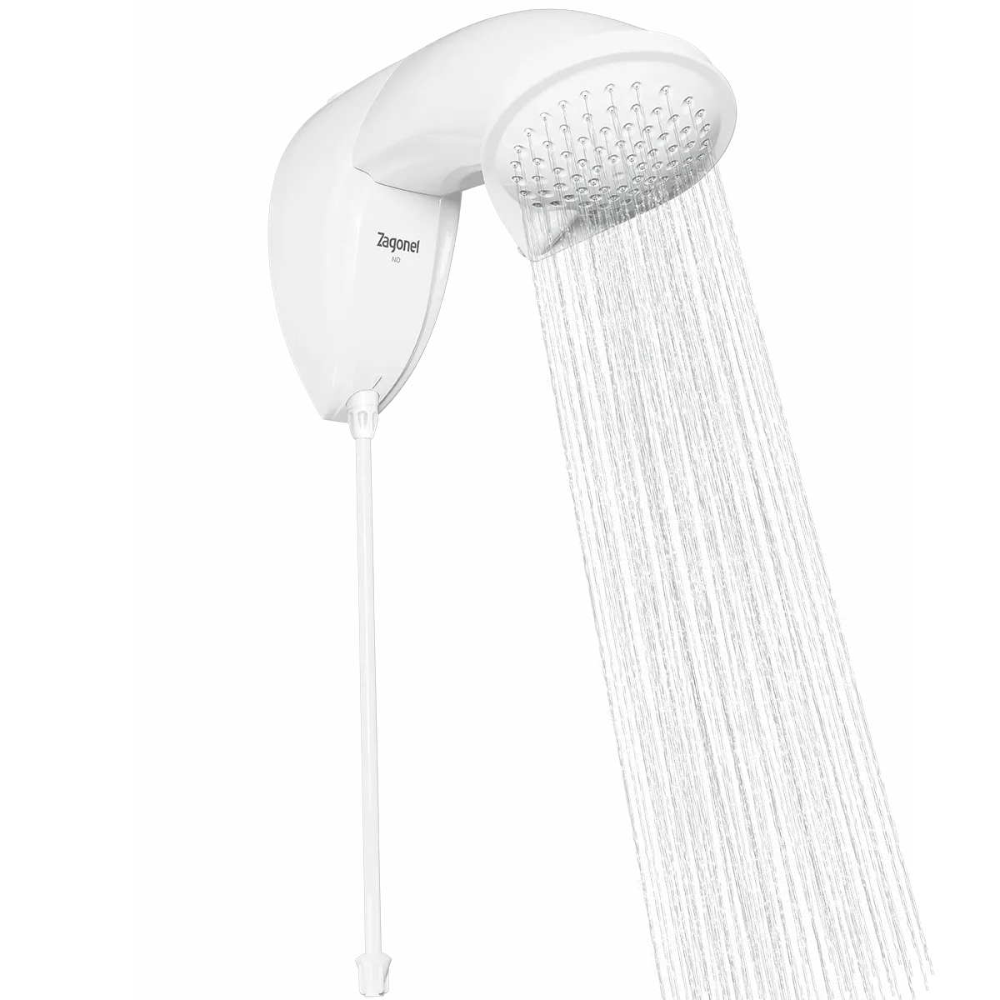
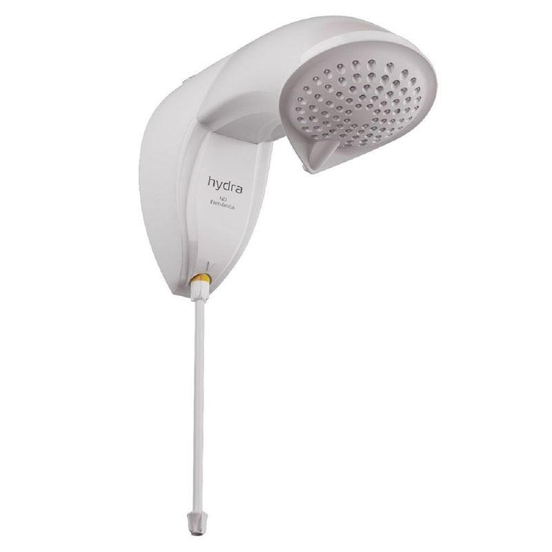
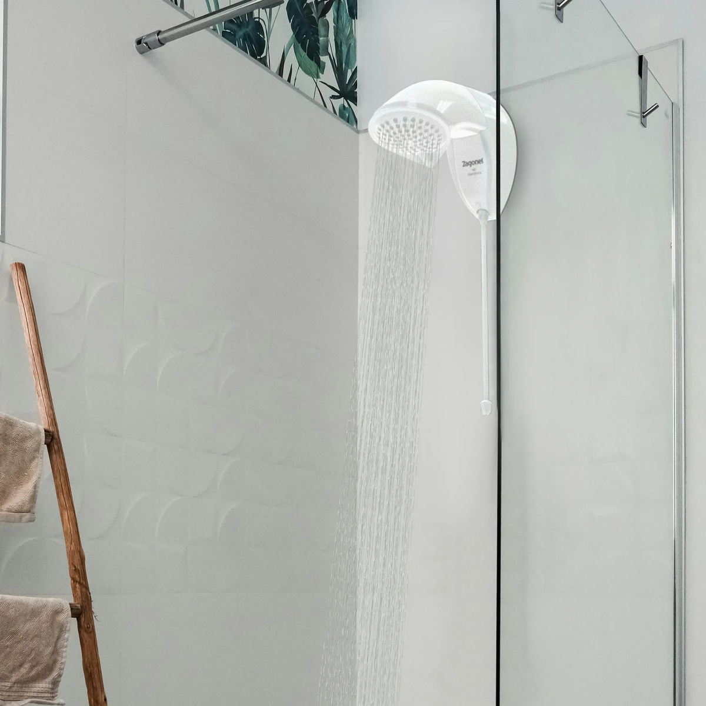
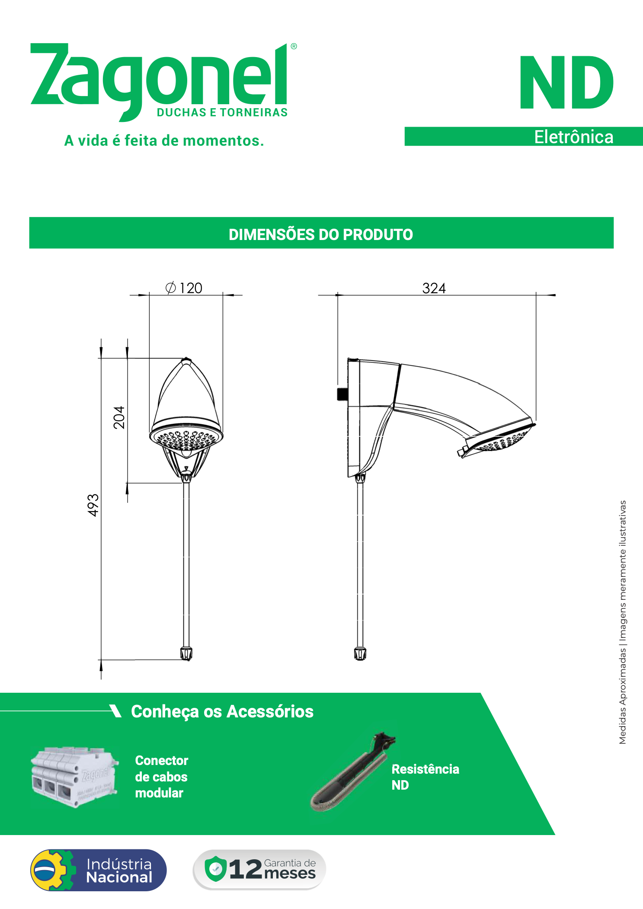
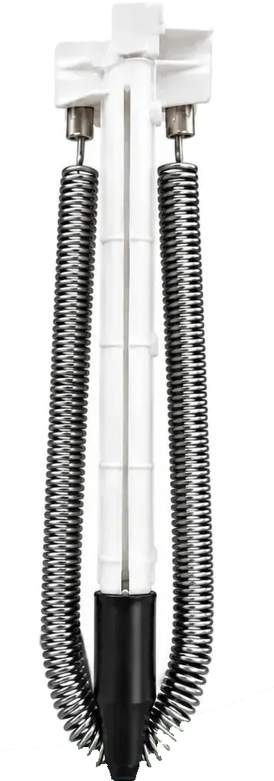

# Roteiro, Mapa de Cenas e Orçamento (Portão 2) — Ducha Eletrônica Zagonel ND Branco (127V e 220V)

- **Produto:** Ducha Eletrônica Zagonel ND Branco (`127V · 5500W`, código `DNDEL55127BR03` e `220V · 7700W`, código `DNDEL77220BR03` — links diretos separados para ambas as voltagens)
- **Duração estimada:** `54 segundos` (`166` palavras escritas / `178` palavras faladas expandidas ≈ `54,0s`; `9:16` vertical, `1080×1920`, área segura `X = 48..887 px`, `Y = 288..1247 px`, legendas dinâmicas de `1 a 3 palavras` em `Y = 1040–1220 px`)
- **Orçamento preliminar de créditos Google Flow:** **`8` créditos** orçados em `360p` (`0,8%` da cota mensal Pro de `1.000` créditos) + **`0` crédito** no *upscale* para `1080p` (`≤ 10s`); o arquivo [flow_cena02_360p.mp4](assets/flow_cena02_360p.mp4) (`8,04s`) já está gerado em disco (**`0` crédito adicional** se reaproveitado na Cena 02).
- **Elegibilidade ao Mercado Livre Clips:** **Pendente de trecho em filmagem real** — a fala principal é 100% isenta de preço variável, mas a Cena 02 utiliza clipe gerado em IA (`flow_ia`); pronta para **YouTube Shorts, Instagram Reels e TikTok** (com marcação de IA pelo `REQ-007`).
- **Aviso determinístico (REQ-007):** **SIM** (contém cena classificada como `flow_ia`).
- **Palavra-chave (DM Instagram / `REQ-010`):** `ZAGONEL` *(resposta automática entregando os links diretos separados para `127V` e `220V`, com fallback para a vitrine na bio)*

---

## Opções de Gancho (`0–3s`)

Conforme [guia-roteirista.md](../../.agents/skills/roteirista/references/guia-roteirista.md), avaliam-se 3 aberturas concorrentes por ângulos distintos, conectando imediatamente a dor física ao benefício prático principal (`Real → Raio-X 3D → Uso Real → Real`):

- **Opção A — Dor Cotidiana & Costura com o Benefício Principal *(adotada)*:** *"Por que chuveiro comum de três estalos nunca fica na temperatura certa? Ou a água ferve, ou você fecha o registro e perde metade do jato! Abri em raio-x a clássica ducha ND, da antiga Thermosystem e Hydra, hoje da Zagonel!"* *(Conecta nos primeiros segundos a limitação das 3 chaves fixas à dor real de fechar o registro e perder pressão de água, iniciando o scanner direto da foto oficial real da Ducha Zagonel ND para o modelo 3D em Raio-X com compartimentos estanques.)*
- **Opção B — Mistério / Bastidor de Engenharia (O "Dimmer" por Dentro do Chuveiro):** *"Como essa ducha regula o calor sem diminuir a água e sem molhar a placa? Abri em raio-x o segredo da clássica ND, da Thermosystem e Hydra, hoje da Zagonel!"* *(Abre pela curiosidade de ver a divisória estanque entre o tubo de água e o regulador eletrônico tipo dimmer.)*
- **Opção C — Quebra de Expectativa (A Resistência da Antiga ND e Turbo Mudou?):** *"Comprou a nova ducha Zagonel ND e achou que a resistência da antiga Turbo mudou? Abri esse clássico em raio-x para mostrar o encaixe real e como o regulador funciona!"* *(Foco direto na dúvida histórica de quem já teve a linha Thermosystem/Hydra ND ou Turbo.)*

---

## 1. Mapa de Cenas, Motor Visual e Narração Cronometrada

> **Diretrizes aplicadas:** arquitetura narrativa **`Produto Real → Raio-X 3D → Uso Real → Produto Real`** na voz viva do Inspetor Bicho Grilo em 2ª pessoa conforme [guia-roteirista.md](../../.agents/skills/roteirista/references/guia-roteirista.md); todas as `14` frases dentro do teto estrito de `≤ 15` palavras tanto no texto escrito (máx. `14` palavras) quanto na forma falada expandida pelo Dicionário Fonético (máx. `15` palavras); morfologia 3D fiel em "L" invertido / pescoço curvo (`324 mm × 204 mm × Ø 120 mm`, haste vertical inferior de `493 mm` saindo do bico do bojo traseiro) com **separação física 100% estanque entre o tubo hidráulico fechado / Câmara Quente superior (`700 ml`) e o compartimento eletrônico seco inferior**; HUD Minimalista de Raio-X em português acessível ao leigo (`top bar` discreta, `1 a 2` *leader lines* de `1 a 3 palavras`, pílula única de benefício/estado e legenda dinâmica inferior de `1 a 3 palavras`).

| Cena | Tempo | Motor Visual | Intenção Vocal, Ação do Inspetor Bicho Grilo & Visual em Tela | Referências Visuais | Fala Exata (Narração PT-BR) |
|---|---|---|---|---|---|
| **01 · Gancho das 3 Posições, Costura com o Benefício & Transição Foto Real → Raio-X 3D** | `00s–11s` (`11s`) | `Rig 2.5D` + `Determinístico` | **Intenção vocal:** `[intrigado → identificação imediata com a dor → fascínio de engenharia]`. **Presença do Inspetor (`Rig 2.5D`):** intervenção rápida à esquerda com `inspecao_lupa` acionando o *scanner* de transição da foto real para o Raio-X 3D. **Ancoragem no Produto Real & Coreografia 3D Raio-X:** abre exibindo em grande destaque a **foto oficial real nítida da Ducha Zagonel ND jorrando água (`assets/zagonel_oficial_nd.png`)**; em seguida, um feixe de *scanner / cross-fade alinhado* transforma a foto real no modelo 3D em Raio-X (`#00e5ff`) na morfologia fiel em "L" invertido (`324 × 204 × Ø 120 mm`, haste vertical de `493 mm`), revelando com nitidez a **parede divisória estanque** entre o **tubo hidráulico superior vedado** e o **compartimento eletrônico seco no bico inferior do bojo traseiro**. **HUD Minimalista Acessível:** • **Top bar:** `• DUCHA ZAGONEL ND (REAL → RAIO-X)` (`ilustrativo`) • **Leader lines (3D→2D):** `câmara de água vedada` e `haste de calor` • **Pílula de estado:** `🟢 BENEFÍCIO: AJUSTE FINO COM JATO 100% ABERTO` |    | *"Por que chuveiro comum de três estalos nunca fica na temperatura certa? Ou a água ferve, ou você fecha o registro e perde metade do jato! Abri em raio-x a clássica ND, da Thermosystem e Hydra, hoje da Zagonel!"* |
| **02 · A Costura do "Dimmer de Calor" (TRIAC para o Leigo) + Vídeo Real no Banho** | `11s–22s` (`11s`) | `Determinístico` + `Flow Omni 360p -> 1080p` (`flow_ia`) | **Intenção vocal:** `[didático e empolgado → alívio prático]`. **Presença do Inspetor (`Rig 2.5D`):** fora de quadro (palco `9:16` dedicado ao *macro* 3D e ao produto real funcionando no banho). **Ancoragem no Produto Real & Coreografia 3D Raio-X:** **1ª metade (`11s–16s`):** *macro dolly-in* 3D Raio-X no bico inferior seco do bojo traseiro, mostrando a parede divisória estanque que isola a placa eletrônica da água, a haste vertical girando o eixo do potenciômetro/dimmer (**TRIAC** explicado como um *dimmer de luz*) e a aba metálica do dissipador encostada apenas por fora na parede do tubo frio. **2ª metade (`16s–22s`):** exibe em grande destaque o **vídeo da Ducha Zagonel ND funcionando em uso prático no banheiro (`assets/flow_cena02_360p.mp4` + foto real instalada `assets/zagonel_nd_uso_real.png`)** com a mão girando a haste suavemente e o jato `100%` forte aberto. **HUD Minimalista Acessível:** • **Top bar:** `• REGULADOR GRADUAL (COMO UM DIMMER)` (`uso real + 3D`) • **Leader lines (3D→2D):** `regulador (dimmer TRIAC)` e `compartimento seco` • **Pílula de estado:** `🟢 JATO 100% FORTE · CALOR NO PONTO CERTO` |  [Clipe Flow 360p (8s)](assets/flow_cena02_360p.mp4)  | *"Em vez de três chaves fixas, a haste gira um regulador eletrônico no compartimento seco! Essa peça se chama TRIAC e funciona como um dimmer de luz. Você escolhe o calor exato no banho sem mexer na pressão da água!"* |
| **03 · Tubo Hidráulico Fechado, Diafragma Anti-Queima a Seco e Regra nº 1 do Manual** | `22s–32s` (`10s`) | `Determinístico` | **Intenção vocal:** `[curioso → alerta técnico protetor de amigo]`. **Presença do Inspetor (`Rig 2.5D`):** fora de quadro (palco `9:16` em **tela cheia 3D Raio-X limpa** para máxima clareza do caminho confinado da água). **Ancoragem no Produto Real & Coreografia 3D Raio-X:** corte seccional 3D Raio-X do bojo traseiro mostrando o **duto/tubo interno fechado** com **linhas de fluxo contínuas (*streamlines*) e água azul-ciano confinada exclusivamente dentro das paredes do tubo** (completamente isolada da placa eletrônica seca no bico inferior!). O fluxo sobe até a cápsula selada do **diafragma de borracha** no topo (`≥ 10 kPa / 1 m.c.a.`), erguendo o êmbolo contra a mola e fechando os contatos de cobre somente com a câmara cheia — ilustrando por que deixar correr água fria antes de ligar o disjuntor evita a queima a seco. **HUD Minimalista Acessível:** • **Top bar:** `• SEGURANÇA CONTRA QUEIMA A SECO` (`corte 3D`) • **Leader lines (3D→2D):** `tubo de água vedado` e `trava de pressão (diafragma)` • **Pílula de estado:** `🔵 ÁGUA NO DUTO FECHADO · PARTIDA SEGURA` |   | *"E por onde a água passa? Ela sobe por um tubo fechado e levanta essa borracha chamada diafragma! Ele só liga a energia com a câmara cheia. Por isso, na instalação, deixe correr água fria antes de ligar o disjuntor!"* |
| **04 · Câmara Quente, Mesma Resistência (ND e Turbo!), 127V vs 220V e Haste Branca** | `32s–44s` (`12s`) | `Determinístico` | **Intenção vocal:** `[revelação prática → transparência direta]`. **Presença do Inspetor (`Rig 2.5D`):** fora de quadro (palco `9:16` combinando corte 3D da Câmara Quente com fotos reais nítidas da peça e do acabamento). **Ancoragem no Produto Real & Coreografia 3D Raio-X:** corte 3D da **Câmara Quente (`700 ml`, encaixe de `1/4 de volta`)** no pescoço curvo superior mostrando a água confinada ao redor da espiral incandescente (`#ff5500` → `#ffa94d`) até sair em **jatos contínuos pelos `78` furos (`Ø 0,7 mm`) do espalhador (`Ø 120 mm`)**, pareado com o **recorte fotográfico real da resistência comprida (`assets/resistencia_tse0277_cut.png` — confirmando o mesmo encaixe das antigas ND e ND/TS Turbo)** e o comparativo circular real da **haste `100%` branca da Zagonel** (`assets/zagonel_oficial_nd.png` vs anel colorido antigo em `assets/era2_hydra_nd.jpg`). **HUD Minimalista Acessível:** • **Top bar:** `• MESMA RESISTÊNCIA ND/TURBO · 127V VS 220V` (`peça real + 3D`) • **Leader lines (3D→2D):** `mesmo encaixe ND/Turbo` e `haste 100% branca` • **Pílula de estado:** `🟠 220V (7700W): ESQUENTA MAIS · 127V (5500W): FIO 10 mm²` |    | *"No pescoço curvo, a resistência continua a mesma da antiga ND e Turbo! Em 220V ela esquenta mais que em 127. Use o cabo certo e repare: a Zagonel deixou a haste toda branca!"* |
| **05 · Fechamento com Produto Real Funcionando e CTA (127V e 220V)** | `44s–54s` (`10s`) | `Rig 2.5D` + `Determinístico` | **Intenção vocal:** `[fechamento confiante e parceiro]`. **Presença do Inspetor (`Rig 2.5D`):** retorna à esquerda com `toque_chapeu` ao concluir o raio-x e `apontar_produto` destacando as opções `127V` e `220V`. **Ancoragem no Produto Real & Coreografia 3D Raio-X:** o modelo 3D recompõe sua carcaça branca e faz *cross-fade* de volta para a **foto oficial real da Ducha Zagonel ND jorrando água (`assets/zagonel_oficial_nd.png`)** ao lado da **foto real instalada no banheiro (`assets/zagonel_nd_uso_real.png`)**, fechando o ciclo visual no produto real. **HUD Minimalista Acessível:** • **Top bar:** `• ZAGONEL ND OFICIAL · 4,8★ (3.152 AVAL.)` (`produto real`) • **Leader lines (3D→2D):** `127V · 5500W` e `220V · 7700W` • **Pílula de estado:** `🟢 LINK NA BIO · OU COMENTE: ZAGONEL` |   | *"É o projeto clássico com mais de três mil avaliações positivas e banho sem aperto! Quer a versão 127 ou 220V? Os links separados estão na bio, ou comente ZAGONEL!"* |

---

## 2. Dicionário Fonético de TTS (`REQ-003`)

> As legendas visuais e o HUD minimalista na tela mantêm a grafia técnica oficial (`127V`, `220V`, `ND`, `TRIAC`, `dimmer`, `700 ml`, `1 m.c.a.`, `10 kPa`, `mm²`, `50A`, `40A`); o texto enviado ao motor TTS aplica as substituições abaixo para garantir pronúncia natural em português do Brasil.

| Termo na fala / legenda | Transcrição fonética para TTS (`pt-BR`) | Observação |
|---|---|---|
| `Thermosystem` | `térmosístem` | Marca criadora original da linha eletrônica ND (`2012`) |
| `Hydra` | `ídra` | Marca sob gestão Duratex/Dexco (`2015–2024`) |
| `Zagonel` | `zagonél` | Fabricante atual da linha ND após aquisição concluída em `13/12/2024` |
| `ND` | `êne dê` | Sigla oficial do modelo (pronunciada letra a letra) |
| `TRIAC` | `triáque` | Semicondutor bidirecional de potência explicado como um dimmer eletrônico |
| `dimmer` | `dímer` | Analogia cotidiana de regulador contínuo de intensidade/calor |
| `127` | `cento e vinte e sete` | Tensão nominal da versão de `5.500 W` (`DNDEL55127BR03`) |
| `220V` | `duzentos e vinte volts` | Tensão nominal da versão de `7.700 W` (`DNDEL77220BR03`) |
| `bio` | `bío` | Vitrine de links do perfil com as opções `127V` e `220V` separadas |
| `ZAGONEL` | `zagonél` | Palavra-chave para disparo de DM com os links `127V` e `220V` (`REQ-010`) |

---

## 3. Orçamento Explícito de Créditos do Google Flow (`REQ-003`, ADR `0006`)

| Cena | Duração | Motor Visual | Créditos `Omni Flash 1.2 · 360p` (`1 cr/s`) | Upscale `1080p` (Portão 4, `0 cr` ≤10s) | Status atual |
|---|---|---|---|---|---|
| `01` | `11s` | `Rig 2.5D` + `Determinístico` | `0 créditos` | Não se aplica | Execução 100% local (Foto Real `zagonel_oficial_nd.png` → Scanner Raio-X 3D + `InspectorRig`) |
| `02` | `11s` | `Determinístico` + `Flow Omni 360p -> 1080p` (`flow_ia`) | **`8 créditos`** | `0 crédito` | Macro 3D do regulador seco (`dimmer TRIAC`) + Clipe [flow_cena02_360p.mp4](assets/flow_cena02_360p.mp4) (`8,04s`) já gerado em disco (**`0` crédito adicional** se reaproveitado no Portão 3; `8 créditos` caso regenerado) |
| `03` | `10s` | `Determinístico` | `0 créditos` | Não se aplica | Execução 100% local (Palco 3D Raio-X tela cheia: tubo hidráulico fechado + diafragma anti-queima a seco) |
| `04` | `12s` | `Determinístico` | `0 créditos` | Não se aplica | Execução 100% local (Câmara Quente 3D `700 ml` + foto real da resistência compatível ND/Turbo + haste branca) |
| `05` | `10s` | `Rig 2.5D` + `Determinístico` | `0 créditos` | Não se aplica | Execução 100% local (Remontagem 3D → Foto Real funcionando + `InspectorRig` + CTA `127V`/`220V`) |
| **Total** | **`54s`** | **Pipeline Híbrido Real + Raio-X 3D** | **`8 créditos`** (`0,8%` cota Pro `1.000/mês`) | **`0 crédito`** | Aguardando validação visual de `@Steve` e aprovação do Portão 2 (`REQ-004`) |

---

## 4. Notas de Fidelidade Física e Factual (@Curador)

> **Status da auditoria de fidelidade física e factual (Portões 1, 2 e 3):** **`APROVADO`** pelo `@Curador` após inspeção direta de `ficha.md`, `roteiro.md`, `pacote.md`, `raio_x_3d_studio.html`, dos `5` *styleframes* (`_preview_build/styleframes/styleframe_cena01.png`..`05.png`) e dos `7` *keyframes* finais de `video_final_1080p.mp4` (`_preview_build/keyframes_final/keyframe_cena01.png`..`05.png`).

1. **Isolamento físico 100% estanque (Água vs. Eletrônica Seca):**
   - **Tubo hidráulico fechado superior + Câmara Quente (`700 ml`, trava de `1/4 de volta`):** a água fria que entra pelo nipple traseiro (`1/2" BSP`, `y ≈ +0.38`) sobe exclusivamente confinada dentro de um **duto/tubo plástico fechado** até a cápsula selada do **diafragma elastomérico** no topo (`y ≈ +0.62`, acionamento a partir de `10 kPa / 1 m.c.a.`) e avança apenas pelo interior da **Câmara Quente** no pescoço curvo superior até os **`78` furos (`Ø 0,7 mm`)** do espalhador compacto (`Ø 120 mm`).
   - **Compartimento eletrônico inferior seco (`y < +0.05`):** separado por **parede divisória estanque com anel *O-ring* (`y ≈ +0.08`)**, abriga a seco a placa eletrônica (`potenciômetro rotativo + DIAC + TRIAC`). A água **jamais** inunda o bojo traseiro e **jamais** passa por cima ou cruza a placa eletrônica; apenas a aba metálica do dissipador do `TRIAC` encosta externamente na parede do tubo frio para arrefecimento por condução.
2. **Intercambialidade histórica 100% preservada da Resistência (`Thermosystem → Hydra → Zagonel ND` e `ND/TS/Optima Turbo`):**
   - A resistência longitudinal de encaixe rápido da atual **Zagonel ND Eletrônica** (`9405000163` em `220V / 7700W` e `9405000162` em `127V / 5500W`, equivalente `Pratimix TSE0277 / TSE0155` e legado Hydra `3340.CO.011 / 3340.CO.010`) **não mudou** entre as eras **Thermosystem (2012)**, **Hydra Corona (2015)** e **Zagonel (dez/2024)**, e é **exatamente a mesma resistência** utilizada nos modelos **Eletrônicos Turbo** (`ND Eletrônica Turbo`, `TS Eletrônica Turbo` e `Optima Eletrônica Turbo`, que adicionam apenas a bomba pressurizadora no bojo traseiro).
3. **Especificações normativas, variações essenciais e detalhe visual de acabamento:**
   - **`220V / 7700W` (`DNDEL77220BR03`):** corrente `35 A`, fiação mínima **`6 mm²`**, disjuntor **`40 A`**, elevação térmica INMETRO a `3 L/min` = **`+34,9 °C`** (Classe F).
   - **`127V / 5500W` (`DNDEL55127BR03`):** corrente `43,30 A`, fiação mínima **`10 mm²`**, disjuntor **`50 A`**, elevação térmica INMETRO a `3 L/min` = **`+24,4 °C`** (Classe D).
   - **Regra nº 1 anti-queima a seco e acabamento atual:** obrigatório purgar os `700 ml` da câmara com água fria antes de ligar o disjuntor; na versão atual **Zagonel ND**, a haste vertical inferior (`493 mm`) e sua luva de acoplamento são **100% brancas** (sem o antigo anel colorido da era Hydra).
4. **Checklist visual obrigatório para o Portão 2 e Portão 3 (`@Steve`):**
   - **(a)** Linhas de fluxo (*streamlines*) e partículas de água estritamente confinadas ao tubo fechado superior e à Câmara Quente (`y ≥ +0.20`), acima da parede divisória estanque (`y = +0.08`), sem tocar na placa PCB verde inferior.
   - **(b)** Exibição nítida dos ativos reais verificados: foto oficial da ducha funcionando (`assets/zagonel_oficial_nd.png` nas Cenas 01, 04 e 05), vídeo/foto de uso real no banho (`assets/flow_cena02_360p.mp4` / `flow_cena02_1080p.mp4` + `assets/zagonel_nd_uso_real.png` na Cena 02 e Cena 05) e recorte fotográfico real da resistência compatível ND/Turbo (`assets/resistencia_tse0277_cut.png` na Cena 04).
   - **(c)** HUD minimalista em linguagem acessível ao leigo (`dimmer`, `compartimento seco`, `tubo de água vedado`, `trava de pressão`, `mesmo encaixe ND/Turbo`, `haste 100% branca`) com todas as cotas elétricas e térmicas exatas.
