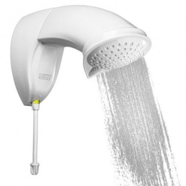

# Roteiro, Mapa de Cenas e Orçamento (Portão 2) — Ducha Eletrônica Zagonel ND Branco (127V e 220V)

- **Produto:** Ducha Eletrônica Zagonel ND Branco (`127V · 5500W` e `220V · 7700W` — links diretos separados para ambas as voltagens)
- **Duração estimada:** ~50 segundos (`9:16` vertical, `1080×1920`, área segura `X = 48..887 px`, `Y = 288..1247 px`, legendas de 1 a 3 palavras em `Y = 1040–1220 px`)
- **Elegibilidade ao Mercado Livre Clips:** **Pendente de trecho em filmagem real** — a fala é totalmente isenta de preço variável, mas a Cena 02 utiliza clipe gerado em IA (`flow_ia`); pronta para **YouTube Shorts, Instagram Reels e TikTok** (com marcação de IA pelo `REQ-007`).
- **Aviso determinístico de conteúdo por IA (`REQ-007`):** **SIM** (contém cena classificada como `flow_ia`).
- **Palavra-chave (DM Instagram / `REQ-010`):** `ZAGONEL` *(resposta entregando os links diretos `127V` e `220V`, com fallback para a vitrine na bio)*

---

## Opções de Gancho (`0–3s`)

Conforme [guia-roteirista.md](../../.agents/skills/roteiro-e-video/references/guia-roteirista.md), avaliam-se 3 aberturas concorrentes com impacto completo dentro de `0–3s`:

- **Opção A — Mistério / Bastidor *(adotada)*:** *"Achou que seu chuveiro favorito sumiu? Eu também — até descobrir o que fizeram com o projeto dele!"* *(7 palavras na 1ª pergunta ≈ 2,5s; cria identificação imediata e abre o loop até o fechamento.)*
- **Opção B — Dor Cotidiana:** *"Ainda fecha o registro pro banho esquentar? Olha o projeto clássico que resolve isso sem perder vazão!"*
- **Opção C — Quebra de Expectativa:** *"Mudaram o nome na etiqueta três vezes... mas o segredo lá dentro continuou igualzinho!"*

---

## 1. Mapa de Cenas, Motor Visual e Narração Cronometrada

> **Diretrizes aplicadas:** voz viva do Inspetor Bicho Grilo em 2ª pessoa conforme [guia-roteirista.md](../../.agents/skills/roteiro-e-video/references/guia-roteirista.md); todas as frases com até `15` palavras inclusive na contagem falada expandida (`~2,5` palavras/s); datas históricas e especificações exibidas em tela; exibição exclusiva do produto real anunciado (`REQ-003`), suas peças/câmara internas e diagramas esquemáticos genéricos (`REQ-015`).

| Cena | Tempo | Motor Visual | Intenção Vocal, Ação do Inspetor Bicho Grilo & Visual em Tela | Referências Visuais | Fala Exata (Narração PT-BR) |
|---|---|---|---|---|---|
| **01 · O Mistério das 3 Eras** | `00s–13s` (`13s`) | `Rig 2.5D` + `Determinístico` | **Intenção vocal:** `[intrigado → surpresa]`. **Visual & Ação:** **Zagonel ND real** em destaque no palco (preservando o logo no corpo do produto); recortes documentais exibem as datas e selos na tela (`2012 · Thermosystem` → `2015 · Hydra ND` → `2024 · Zagonel ND` e imprensa *FIESC · Exame · Anamaco*) enquanto o **Inspetor** alterna `inspecao_lupa` → `analitico`. |   ·  | *"Achou que seu chuveiro favorito sumiu? Eu também — até descobrir o que fizeram com o projeto dele! A antiga Thermosystem virou Hydra. E a Zagonel trouxe o mesmo chuveiro na ND!"* |
| **02 · Controle Eletrônico sem Fechar Registro** | `13s–21s` (`8s`) | `Flow Omni 360p -> 1080p` (`flow_ia`) + `Rig 2.5D` | **Intenção vocal:** `[empolgado / alívio prático]`. **Visual & Ação:** **Clipe de ação `8s` (Google Flow)** guiado pela foto real da Zagonel ND (haste girando, jato aberto e vapor subindo) acompanhado do rótulo técnico `127V (5500W) · 220V (7700W)` e do **Inspetor** em `lanterna_on`. |  [Clipe Flow 360p (8s)](assets/flow_cena02_360p.mp4) | *"Chega de fechar o registro pra esquentar! Nas duas voltagens, você gira a haste e o vapor já sobe!"* |
| **03 · Prova, Transparência e Regras do Manual** | `21s–38s` (`17s`) | `Determinístico` + `Rig 2.5D` | **Intenção vocal:** `[alerta sério → transparência]`. **Visual & Ação:** **Composição programática** (`Pillow`/`numpy` + `ffmpeg`) sobre fotos reais da câmara interna aberta, encaixe ND e resistência própria sem marca, somada a **diagramas esquemáticos genéricos desenhados em Python**: selo `2.965 avaliações · 94,8%`, destaque da haste branca sem adesivo colorido, fluxo de água fria preenchendo a câmara e quadro `127V: 10 mm² / 50 A` · `220V: 6 mm² / 40 A`. **Inspetor** em `analitico`. |    | *"São quase três mil avaliações e 94,8% aprovam. Só atenção: tiraram o adesivo colorido da haste. E na instalação, siga o manual! Encha a câmara com água fria antes de ligar. E use cabo e disjuntor da sua voltagem."* |
| **04 · Fechamento do Loop e CTA (127V e 220V)** | `38s–50s` (`12s`) | `Rig 2.5D` + `Determinístico` | **Intenção vocal:** `[fechamento confiante]`. **Visual & Ação:** **Inspetor** executa `toque_chapeu` → `apontar_produto` destacando a **Zagonel ND** real com o rótulo `Encaixe clássico ND · 127V e 220V` e o selo `COMENTE: ZAGONEL` dentro da área segura. |  | *"O clássico não sumiu — só trocou de sobrenome! Quer conferir em 127 ou 220V? Os dois links tão na bio! Ou comenta ZAGONEL!"* |

---

## 2. Dicionário Fonético de TTS (`REQ-003`)

> As legendas visuais na tela mantêm a grafia técnica correta (`127V`, `220V`, `94,8%`, `ND`); o texto enviado ao motor TTS substitui os termos abaixo para garantir pronúncia natural em português do Brasil.

| Termo na fala / legenda | Transcrição fonética para TTS (`pt-BR`) | Observação |
|---|---|---|
| `Thermosystem` | `térmosístem` | Nome histórico da marca original (`2012`) |
| `Hydra` | `ídra` | Marca sob gestão Duratex/Dexco (`2015–2024`) |
| `Zagonel` | `zagonél` | Marca atual fabricante |
| `ND` | `êne dê` | Código oficial do modelo |
| `127` | `cento e vinte e sete` | Tensão do modelo de `5500W` |
| `220V` | `duzentos e vinte volts` | Tensão do modelo de `7700W` |
| `94,8%` | `noventa e quatro vírgula oito por cento` | Aprovação somada exata no catálogo ML (`87,96% + 6,88%`) |
| `bio` | `bío` | Referência à vitrine de links do perfil (com 127V e 220V) |
| `ZAGONEL` | `zagonél` | Palavra-chave para disparo de DM com os dois links (`REQ-010`) |

---

## 3. Orçamento Explícito de Créditos do Google Flow (`REQ-003`, ADR `0006`)

| Cena | Duração | Motor Visual | Créditos `Omni Flash 1.2 · 360p` (`1 cr/s`) | Upscale `1080p` (Portão 4, `0 cr` ≤10s) | Status atual |
|---|---|---|---|---|---|
| `01` | `13s` | `Rig 2.5D` + `Determinístico` | `0` créditos | Não se aplica | Execução local |
| `02` | `8s` | `Flow Omni 360p -> 1080p` (`flow_ia`) | **`8` créditos** previstos | `0` crédito | Já existe [flow_cena02_360p.mp4](assets/flow_cena02_360p.mp4) (`8s`): **`0` crédito adicional** se aprovado no Portão 3, ou `8` créditos caso seja regenerado |
| `03` | `17s` | `Determinístico` + `Rig 2.5D` | `0` créditos | Não se aplica | Execução local sobre fotos reais da linha ND |
| `04` | `12s` | `Rig 2.5D` + `Determinístico` | `0` créditos | Não se aplica | Execução local |
| **Total** | **`50s`** | **Pipeline Híbrido** | **`8` créditos orçados** (`0,8%` cota Pro `1.000/mês`) | **`0` crédito** | Aguardando aprovação explícita do Portão 2 (`REQ-004`) |
