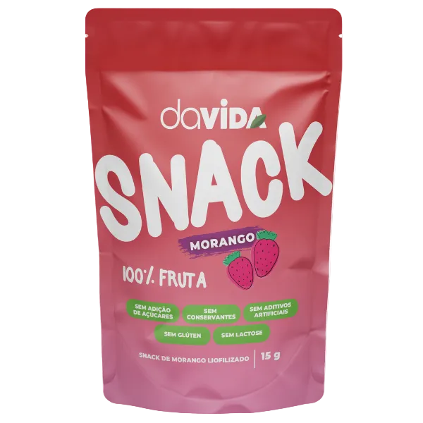
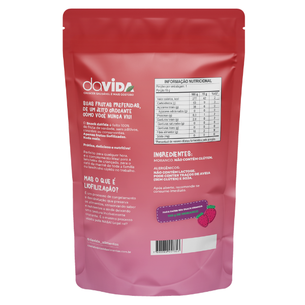
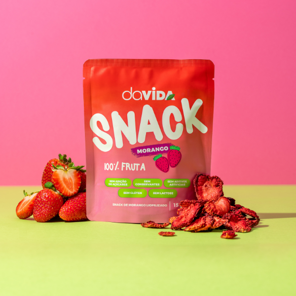
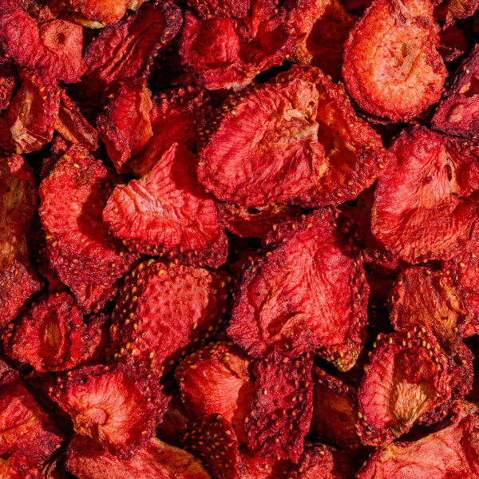
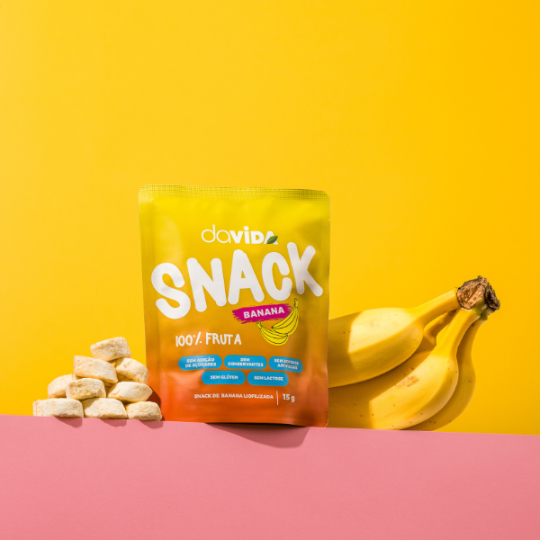
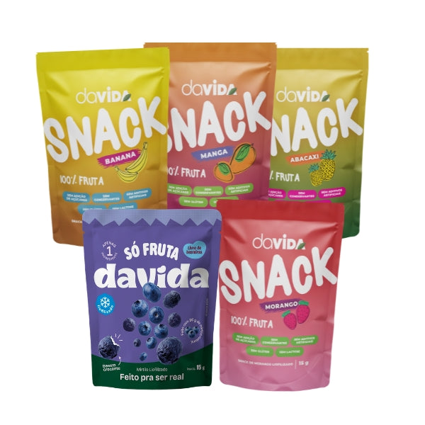
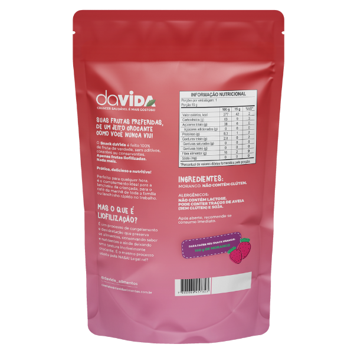
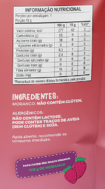
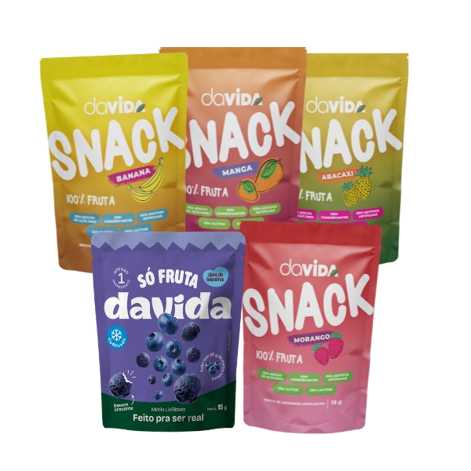
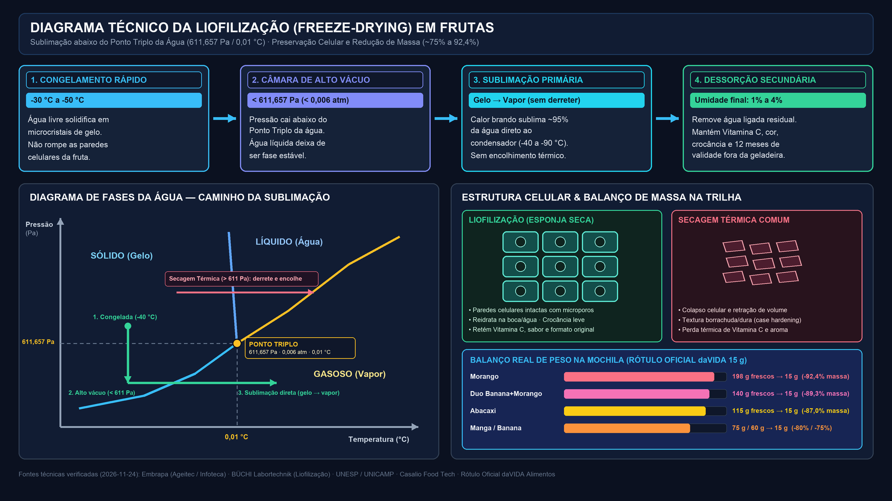

# Ficha de Curadoria (Portão 1) — Fruta Liofilizada daVIDA (Snack Só Fruta 15 g)

> **Data da revisão crítica:** `2026-11-24` (Portão 1 — verificação direta no catálogo oficial da marca, rótulos nutricionais impressos nas embalagens, literatura técnica Embrapa / BÜCHI / UNESP / UNICAMP / Casalio, páginas públicas da Amazon Brasil e extração integral de reviews nos catálogos do Mercado Livre).

## 1. Problema real resolvido

- **O dilema da fruta *in natura* em caminhadas longas, montanhas e travessias:** quem faz *trekking* de vários dias ou ataques de cume precisa de vitaminas, fibras e carboidratos naturais de absorção rápida, mas fruta fresca carrega **75% a 92% de água inerte**, pesa demais na mochila, amassa sob o peso de equipamentos, fermenta fora da geladeira em poucas horas de sol e mela o interior da carga se a casca romper. Por outro lado, frutas secas convencionais (passas ou desidratadas em estufa a ar quente) sofrem encolhimento severo, ficam com textura borrachuda/pegajosa e perdem parte expressiva de compostos termossensíveis como a Vitamina C — enquanto muitos "chips de frutas tropicais" vendidos a granel ou em pacotes econômicos são, na prática, **fritos a vácuo com óleo vegetal e xarope de glicose**.
- **Solução técnica do produto (Liofilização Pura `100%` Fruta em Sachê de Barreira `15 g`):** a linha **Snack Só Fruta Liofilizada daVIDA** remove a água da fruta por **sublimação a frio sob alto vácuo** (sem calor agressivo, sem óleo, sem açúcar adicionado e sem conservantes), preservando a estrutura celular porosa, a cor, o sabor ácido/doce original e micronutrientes termossensíveis com **redução de `75,0%` a `92,4%` de massa** (`1` sachê de `15 g` de morango concentra **`198 g`** de morango fresco) e **validade de `12 meses` em temperatura ambiente** enquanto lacrado.

## 2. História real de engenharia & marca (`2023 → 2026`)

1. **Agosto de 2023 — Fundação da Davida Alimentos Ltda. (São Paulo/SP):** registrada oficialmente em agosto de 2023 sob o **CNPJ `51.692.993/0001-40`** (sede na Rua Abílio Borin, 35, São Paulo/SP), a **daVIDA** nasceu da união entre a nutricionista infantil **Camila Garcia** (`@nutri.infantil`, responsável pelo crivo técnico de composição limpa) e o criador culinário **Betto Auge** (`@bettoauge`, focado em palatabilidade sem aditivos), com a proposta *clean label* de substituir snacks ultraprocessados por ingredientes únicos.
2. **Adoção da liofilização (*freeze-drying*) e combate aos "fake liofilizados":** a marca estruturou sua linha principal **Só Fruta (`15 g`)** exclusivamente em tecnologia de supercongelamento e sublimação em câmara a vácuo — processo historicamente consolidado na alimentação espacial e de montanhismo — e publicou guias técnicos de leitura de rótulo denunciando o avanço de snacks vendidos a granel ou em pacotes transparentes que simulam fruta liofilizada mediante fritura a vácuo com óleo de palma/girassol e xarope de glicose.
3. **Expansão de portfólio para consumo *on-the-go* e travessias:** além dos sachês monodose de **`15 g`** em embalagem laminada opaca de alta barreira (Morango, Banana, Manga, Abacaxi, Maçã, Açaí com Banana, Duo Banana e Morango e Mirtilo), a daVIDA consolidou kits fechados de sabores múltiplos (`Kit Preferidos` com `5` sachês = `75 g` e `Kit Explorador` com `8` sachês = `120 g`) com presença ativa nos quatro principais marketplaces brasileiros.

**Fontes verificadas (links profundos, lidos em `2026-11-24`):**
- [daVIDA Alimentos — Página Institucional "Sobre Nós" e CNPJ `51.692.993/0001-40`](https://davidaalimentos.com/pages/sobre-nos) *(lido em `2026-11-24`)*
- [daVIDA Alimentos — Catálogo Oficial de Liofilizados (`products.json`)](https://davidaalimentos.com/collections/liofilizados/products.json) *(lido em `2026-11-24`)*
- [daVIDA Alimentos — Guia Técnico "Fake liofilizados: como identificar e por que isso importa" (`23/11/2026`)](https://davidaalimentos.com/blogs/news/fake-liofilizados-como-identificar-e-por-que-isso-importa) *(lido em `2026-11-24`)*

## 3. Especificações técnicas, auditoria de reviews (1★–3★) e consenso

### 3.1 Ficha técnica oficial por variação essencial (Rótulos daVIDA `15 g`)

> **Evidência direta:** todos os números nutricionais, pesos equivalentes de fruta fresca e alertas de conservação abaixo foram lidos diretamente nos rótulos oficiais impressos no verso das embalagens (`davidaalimentos.com/collections/liofilizados/products.json`, imagens oficiais verificadas em `2026-11-24`).

| Variação essencial (`15 g` líq.) | SKU | Fruta fresca usada | Redução de massa | Energia (`15 g` / `100 g`) | Carboidratos / Açúcares totais / Adicionados | Proteína / Fibra / Sódio (`15 g`) |
|---|---|---|---|---|---|---|
| **Morango** *(EAN `7898968451323`)* | `SFMO` | **`198 g`** de morango | **`-92,4%`** (`183 g` água removida) | `42 kcal` / `277 kcal` | `9 g` / `6 g` / **`0 g`** | `1 g` / `2 g` / `0 mg` |
| **Duo Banana e Morango** | `SF02` | **`140 g`** (`50 g` banana + `90 g` morango) | **`-89,3%`** (`125 g` água removida) | `48 kcal` / `323 kcal` | `11 g` / `9 g` / **`0 g`** | `1 g` / `2 g` / `0 mg` |
| **Abacaxi** | `SFA1` | **`115 g`** de abacaxi | **`-87,0%`** (`100 g` água removida) | `58 kcal` / `384 kcal` | `13 g` / `12 g` / **`0 g`** | `0,8 g` / `1,3 g` / `3,3 mg` |
| **Manga** | `SFM1` | **`75 g`** de manga | **`-80,0%`** (`60 g` água removida) | `56 kcal` / `371 kcal` | `14 g` / `13 g` / **`0 g`** | `0 g` (`2 g/100 g`) / `1 g` / `1 mg` |
| **Banana** | `SFB1` | **`60 g`** de banana | **`-75,0%`** (`45 g` água removida) | `55 kcal` / `368 kcal` | `13 g` / `12 g` / **`0 g`** | `1 g` / `1 g` / `0 mg` |
| **Mirtilo (*Só Fruta*)** | `SFMI` | **`~96 g`** de mirtilo | **`-84,4%`** (`~81 g` água removida) | N/D no JSON público | Sem açúcar adicionado | `100%` mirtilo |

- **Parâmetros gerais da linha (`15 g`) e variações de kit:**
  - **Sabores adicionais ativos no catálogo:** **Maçã (`15 g`, SKU `SFMC`)** e **Açaí com Banana (`15 g`, SKU `SFAC`)**, além dos combos de travessia **Kit Preferidos (`5 × 15 g = 75 g`, SKU `KPF` — `~588 g` de fruta fresca equivalente nos 5 sabores principais)** e **Kit Explorador (`8 × 15 g = 120 g`, SKU `KDS`)**.
  - **Lista de ingredientes e alergênicos:** exclusivamente a fruta (`100%` fruta, zero conservantes, zero corantes, zero óleos e zero gorduras *trans*); **não contém glúten**; **não contém lactose** *(rótulo declara traços possíveis de aveia sem glúten e soja por compartilhamento fabril)*.
  - **Embalagem, peso bruto e validade:** sachê *stand-up pouch* laminado opaco com barreira contra umidade e luz, termosselado no topo com picote rasgável (**sem fecho *zip-lock* reutilizável**); peso bruto unitário declarado no catálogo `21 g` (`15 g` líquidos + `6 g` de embalagem); **validade de `12 meses` fora da geladeira** enquanto lacrado; orientação impressa no verso: **`"Após aberto, recomenda-se consumo imediato."`**

### 3.2 "Por Dentro" + Morfologia do Processo de Liofilização (*Freeze-Drying*)

> **Distinção de evidência (`REQ-001`):** os pesos frescos equivalentes, tabelas nutricionais e instruções de conservação são **dados nominais verificados diretamente nos rótulos oficiais da daVIDA (`2026-11-24`)**; as faixas termodinâmicas de temperatura, pressão de ponto triplo, sublimação, dessorção secundária e preservação celular e de ácido ascórbico decorrem da **literatura técnica e agroindustrial verificada na Embrapa, BÜCHI Labortechnik, UNESP, UNICAMP e Casalio Food Tech (`2026-11-24`)** — sintetizadas visualmente em `assets/diagrama_processo_liofilizacao.png`.

1. **Etapa 1 — Congelamento Rápido (`-30 °C` a `-50 °C`):**
   - A fruta fatiada ou inteira é submetida a congelamento rápido para solidificar toda a água livre em **microcristais de gelo** finos e uniformes. Ao contrário do congelamento lento (que gera cristais grandes pontiagudos capazes de perfurar membranas), o congelamento rápido preserva a geometria original das **paredes celulares vegetais**, transformando a rede de gelo em um "esqueleto" temporário que sustenta o volume do tecido.
2. **Etapa 2 — Câmara de Alto Vácuo abaixo do Ponto Triplo (`< 611,657 Pa` / `< 0,006 atm`):**
   - No diagrama de fases da água pura, o **Ponto Triplo** ocorre exatamente a **`0,01 °C`** e **`611,657 Pa`** (`6,11 mbar` / `4,58 mmHg` / `~0,006 atm`), onde sólido, líquido e vapor coexistem em equilíbrio. Dentro da câmara hermética do liofilizador, bombas de vácuo derrubam a pressão para patamares estritamente **abaixo de `611,657 Pa`** — região termodinâmica onde a água líquida **deixa de ser estável**.
3. **Etapa 3 — Sublimação Primária (Gelo sólido → Vapor direto, sem derreter):**
   - Com aquecimento controlado das bandejas sob alto vácuo, fornece-se apenas o calor latente necessário para o gelo realizar **sublimação direta** (passagem do estado sólido para vapor, contornando a fase líquida). O vapor migra para fora dos tecidos da fruta e é capturado por um condensador criogênico (`-40 °C` a `-90 °C`), removendo cerca de **`90%` a `95%`** da água livre sem gerar tensão superficial líquida — evitando o colapso capilar, o encolhimento e a textura borrachuda ou dura (*case hardening*) típicos da desidratação térmica por ar quente.
4. **Etapa 4 — Dessorção Secundária (`1%` a `4%` de umidade residual) e Morfologia de "Esponja Seca":**
   - Na secagem secundária, eleva-se brandamente a temperatura sob vácuo mantido para remover moléculas de água quimicamente ligada à matriz vegetal, reduzindo a umidade residual final para **`1%` a `4%`**.
   - **Morfologia final e efeito na boca e na trilha:** cada cristal de gelo sublimado deixa um microporo aberto sustentado pela parede celular intacta, formando uma arquitetura rígida de **"esponja seca porosa"** (`assets/davida_morango_macro_textura.png` e `assets/diagrama_processo_liofilizacao.png`). Ao morder, a matriz estala crocante e reidrata instantaneamente na saliva (ou em água/mingau no acampamento); na ausência de água livre, calor excessivo e oxigênio durante o processo, inibe-se a proliferação microbiana (dispensando conservantes e geladeira por `12 meses`) e preserva-se grande fração dos compostos bioativos termolábeis, como a **Vitamina C (ácido ascórbico)** e as antocianinas.
   - **Contraponto morfológico crítico da embalagem (`15 g`):** justamente por ser uma esponja seca com `1%–4%` de umidade residual, a fruta liofilizada é **altamente higroscópica** (puxa umidade do ar em minutos) e **friável sob compressão**. Por isso o sachê daVIDA usa filme metalizado opaco hermético (`assets/davida_morango_pouch.png`), mas **não traz fecho *zip-lock***, exigindo consumo imediato após o rasgo na trilha para não amolecer ("textura de isopor").

**Fontes técnicas verificadas (lidas em `2026-11-24`):**
- [BÜCHI Labortechnik — Princípios Termodinâmicos da Liofilização e Ponto Triplo (`6,11 mbar`)](https://www.buchi.com/pt/knowledge/tecnologias/liofiliza%C3%A7%C3%A3o) *(lido em `2026-11-24`)*
- [Casalio Food Tech — Guia de Rendimentos na Liofilização e Etapas (`1%–4%` umidade residual, Morango `8%–10%`, Banana `18%–29,5%`, Manga `15%–16,7%`, Abacaxi `13%–20%`)](https://casalio.com.br/rendimentos-liofilizacao-guia-completo/) *(lido em `2026-11-24`)*
- [Embrapa Ageitec — Banana Liofilizada (Pós-produção / Processamento)](https://www.embrapa.br/web/agencia-de-informacao-tecnologica/cultivos/banana/pos-producao/pos-colheita/processamento/produtos/banana-liofilizada) e [Embrapa Notícias — Morango Liofilizado](https://www.embrapa.br/busca-de-noticias/-/noticia/58437757/morango-liofilizado-com-selo-brasil-certificado-estara-disponivel-no-mercado-em-2021) *(lidos em `2026-11-24`)*
- [Embrapa ALICE — Dissertação/Documento sobre Liofilização (`ID437502013TSleite.pdf`)](https://www.alice.cnptia.embrapa.br/alice/bitstream/doc/1051341/1/ID437502013TSleite.pdf), [UNESP Repositório Institucional](https://repositorio.unesp.br/bitstreams/8e7caca2-f57e-4170-bd53-3430a2b34641/download) e [UNICAMP Repositório](https://repositorio.unicamp.br/Busca/Download?codigoArquivo=584951&tipoMidia=0) *(parâmetros de congelamento `-30 °C` a `-50 °C`, condensador `-40 °C` a `-90 °C`, dessorção secundária e proteção de paredes celulares/Vitamina C confirmados via resumo público em `2026-11-24`)*

### 3.3 Consenso de montanhismo/trilha e armadilha dos "fake liofilizados"

- **Consenso entre praticantes de *trekking* e nutrição *clean label*:** frutas liofilizadas monodose (`15 g`) resolvem o transporte de frutas frescas em travessias de média e longa duração por combinarem **peso insignificante (`21 g` brutos/sachê)**, zero necessidade de refrigeração e ingestão limpa sem óleos ou açúcares refinados. Em comparação direta com marcas de nicho outdoor (como **LioNutri/Liofoods**, mais focadas em refeições quentes e com presença esparsa nos marketplaces) e concorrentes de snack (`Solo Snacks Fruta Pocket`, ausente na Amazon Brasil e sem variação de morango puro), a **daVIDA** oferece o maior espectro de sabores puros (incluindo Morango) com distribuição consolidada nos quatro marketplaces.
- **Alerta de mercado verificado ao vivo (`fake liofilizados` e embalagens sem barreira):** na auditoria pública do Mercado Livre em `2026-11-24`, anúncios concorrentes genéricos de "morango liofilizado 1 kg" (`MLB63462101`) acumulam denúncias `1★` de compradores descobrindo **adição oculta de açúcar** na embalagem entregue (*"O produto contém açúcar. No anúncio diz q não"*), e pacotes genéricos de `250 g` (`MLB2087891608`) entregam **saco plástico transparente comum sem fecho zip**, facilitando oxidação e amolecimento por umidade. Esse contraste valida a escolha de produto embalado individualmente em barreira laminada opaca com ingrediente único declarado no rótulo.

### 3.4 Auditoria quantitativa de reviews (`1★` a `3★`) — verificada em `2026-11-24`

- **Distribuição exata das 5 faixas no pool consolidado de catálogos daVIDA no Mercado Livre (`MLB2078372053` Kit Degustação + `MLB2090221032` Duo Banana e Morango + `MLB56338512` Manga — `N = 27` avaliações escritas extraídas integralmente via `/noindex/catalog/reviews/.../search` em `2026-11-24`):**
  - **40,74% (5★)** (`11` avaliações)
  - **22,22% (4★)** (`6` avaliações)
  - **14,81% (3★)** (`4` avaliações)
  - **11,11% (2★)** (`3` avaliações)
  - **11,11% (1★)** (`3` avaliações)
  - *Soma exata:* **`99,99%`** (`62,96%` positivas `4★–5★` vs **`37,04%`** neutras/negativas `1★–3★` = `10` avaliações).
- **Amostra integral lida dos `N = 10` comentários `1★–3★` no pool principal do Mercado Livre (`4` de `3★`, `3` de `2★` e `3` de `1★`):** *(Nota: um mesmo comentário pode citar mais de um padrão.)*
  1. **Acidez natural do morango puro ou rejeição ao sabor sem açúcar (`5 / 10` — `50,0%`):** relatos apontando *"Morango e bem azedo"*, *"Morango extremamente azedo…"* (`2★`), *"Nao gostei do sabor"* (`1★`), *"Sao horriveis, gosto ruim, textura ruim"* (`1★`) e *"Produto fraquíssimo, sem sabor"* (`2★`). **Causa real de composição:** como não leva açúcar adicionado, xarope de glicose nem aromatizante, a remoção de `92,4%` da água concentra os ácidos orgânicos naturais do morango *in natura* (se a fruta colhida for ácida, o snack fica intensamente ácido).
  2. **Percepção de quantidade baixa e preço elevado por grama (`4 / 10` — `40,0%`):** queixas de *"muito caro pra quantidade que vem, é pouquíssimo em cada pacotinho"* (`3★`), *"quantidade ínfima"* (`2★`), *"Pouco"* (`3★`) e *"Vem muito pouco dentro do pacote, que acaba ficando caro"* (`2★`). **Explicação física:** `15 g` líquidos resultam da desidratação de `60 g` a `198 g` de fruta fresca em um ciclo lento de alto vácuo (`~25–35 h` em liofilizadores industriais); o consumidor que compara o preço de `15 g` com pacotes pesados de fruta hidratada ou chips fritos sofre choque de expectativa de volume.
  3. **Textura fofa/"isopor" ou perda de crocância (`2 / 10` — `20,0%`):** *"não é crocante como aparece nas propagandas, ele é fofo, tem mais textura de isopor"* (`3★`) e *"textura ruim"* (`1★`). **Característica estrutural + cuidado de embalagem:** a liofilização cria uma rede microporosa rígida e aerada (muito diferente da crocância dura/oleosa de chips fritos), e a ausência de zíper reutilizável exige consumo imediato após abrir para que a umidade atmosférica não amoleça os poros rapidamente.
  4. **Pedaços quebrados no transporte (`1 / 10` — `10,0%`):** *"Não gostei muito do produto muito quebrado as frutas"* (`3★`). **Fragilidade física inerente:** sem água nem óleo plastificante, as fatias porosas quebram e esfarelam facilmente se comprimidas em pacotes moles durante o frete (ou no fundo de uma mochila de ataque).
  5. **Notas baixas com texto genérico positivo (`2 / 10` — `20,0%`):** `"Bom"` marcado como `3★` (`MLB2090221032`) e `"Bom."` marcado como `1★` (`MLB56338512`), sem defeito declarado no texto.
- **Amostras secundárias cruzadas (`2026-11-24`):**
  - **Amazon Brasil (`https://www.amazon.com.br/s?k=fruta+liofilizada`, lido em `2026-11-24`):** `B0HBD2Q4LJ` Morango `15 g` (`3,5★`, `2` aval.), `B0HBCT3TQF` Mix Banana e Morango `15 g` (`2,7★`, `3` aval.), `B0HBCWCFDR` Maçã `15 g` (`5,0★`, `1` aval.) e `B0HBCYFP2D` Banana `15 g` (`5,0★`, `1` aval.) — confirmando a polarização típica entre `5,0★` nos sabores doces (banana/maçã) e notas mais baixas quando envolve a acidez do morango puro e o choque de preço/grama (`15 g`).
  - **Loja oficial `davidaalimentos.com` (Judge.me):** `Morango Liofilizado 15 g` com **`5,0★` (`4` avaliações)** elogiando o sabor fiel de fruta fresca sem gosto artificial de bala e a alta aceitação infantil.

## 4. Confronto entre marketplaces e links principais (Fase 1)

> **Estado de verificação nesta sessão (`2026-11-24`):** não foi utilizado navegador autenticado de afiliado (`browser` indisponível nesta instância) e não há credenciais de API de afiliados configuradas no repositório. Portanto, **taxas de comissão (`GANHOS %` / SiteStripe / Shopee / Magalu) e links curtos de afiliado permanecem marcados como não verificado nesta sessão** até geração na sessão logada do usuário.

| Marketplace (Fase 1) | Variações essenciais cobertas (`15 g` e kits) | Preço / Vendedor / Entrega (`2026-11-24`) | Avaliações & Comissão | Links canônicos públicos verificados |
|---|---|---|---|---|
| **Mercado Livre** *(Principal indicado por maior variedade de sabores/kits e prova social auditada)* | **Todas** (Morango, Banana, Manga, Maçã, Duo Banana e Morango, Kits de 5 unid. e Kit Degustação na Loja Oficial `DAVIDA ALIMENTOS`) | Preço/frete ao vivo nas páginas de produto bloqueado por verificação de conta no acesso HTTP automatizado *(referência oficial da loja da marca: `R$ 22,90` a `R$ 27,90`/sachê avulso; Kit 5 `R$ 109,50`; Kit 8 `R$ 174,00`)* | **Pool catalogado `N = 27` (`MLB2078372053`, `MLB2090221032`, `MLB56338512`) auditado ao vivo em `2026-11-24`**. Comissão `GANHOS %` e link curto: **não verificado nesta sessão** | • **Kit Degustação:** [`MLB2078372053`](https://www.mercadolivre.com.br/kit-fruta-liofilizada-degustacao-snack-davida-mix-sabores/p/MLB2078372053) • **Kit 5 Morango 15g:** [`MLBU3587020311`](https://www.mercadolivre.com.br/kit-5-un-snack-morango-fruta-liofilizado-davida--15g/up/MLBU3587020311) • **Duo Banana+Morango 15g:** [`MLB2090221032`](https://www.mercadolivre.com.br/fruta-liofilizada-duo-banana-morango-snack-crocante-davida/p/MLB2090221032) • **Manga 15g:** [`MLB56338512`](https://www.mercadolivre.com.br/snack-manga-liofilizada-davida-15g/p/MLB56338512) • **Banana 15g:** [`MLBU3416150669`](https://www.mercadolivre.com.br/fruta-liofilizada-banana-chips-snack-davida-saudavel-fitness/up/MLBU3416150669) • **Maçã 15g:** [`MLBU3553521522`](https://www.mercadolivre.com.br/snack-maca-davida-fruta-liofilizada-100-saudavel-sem-gluten/up/MLBU3553521522) |
| **Amazon Brasil** *(Alternativa verificada ao vivo)* | Morango `15 g`, Mix Banana e Morango `15 g`, Maçã `15 g` e Banana `15 g` | Verificado ao vivo (`HTTP 200` na busca `2026-11-24`): • **Morango 15g:** **`R$ 29,22`** • **Banana+Morango 15g:** **`R$ 24,90`** • **Maçã 15g:** **`R$ 24,90`** • **Banana 15g:** **`R$ 24,90`** | Morango `3,5★` (`2` aval.); Banana+Morango `2,7★` (`3` aval.); Maçã `5,0★` (`1` aval.); Banana `5,0★` (`1` aval.). Comissão SiteStripe / link curto: **não verificado nesta sessão** | • **Morango 15g:** [`dp/B0HBD2Q4LJ`](https://www.amazon.com.br/dp/B0HBD2Q4LJ) • **Banana+Morango 15g:** [`dp/B0HBCT3TQF`](https://www.amazon.com.br/dp/B0HBCT3TQF) • **Maçã 15g:** [`dp/B0HBCWCFDR`](https://www.amazon.com.br/dp/B0HBCWCFDR) • **Banana 15g:** [`dp/B0HBCYFP2D`](https://www.amazon.com.br/dp/B0HBCYFP2D) |
| **Shopee Brasil** | Morango `15 g`, Kit 5 Maçã `15 g` e catálogo da loja oficial da marca | Busca pública (`2026-11-24`) confirma anúncios ativos da loja oficial; preço vigente no carrinho **não verificado nesta sessão** *(SPA client-side)* | Nota/vendas e comissão Shopee / link curto: **não verificado nesta sessão** | • **Morango 15g:** [`Snack Morango Davida`](https://shopee.com.br/Snack-Morango-Davida-Fruta-Liofilizada-Natural-Sem-A%C3%A7%C3%BAcar-Gl%C3%BAten-Davida-Saud%C3%A1vel-Fitness-i.1663788163.58255857570) • **Kit 5 Maçã 15g:** [`Kit 5 Maçã Davida`](https://shopee.com.br/Kit-5-Snack-Ma%C3%A7%C3%A3-Fruta-Liofilizada-Davida-15g-Natural-Saud%C3%A1vel-i.1663788163.23899179861) |
| **Parceiro Magalu** | Snack de Morango Sem Açúcar `15 g` | Página pública indexada (`2026-11-24`); preço vigente e estoque **não verificado nesta sessão** *(bloqueio anti-bot no acesso direto)* | Avaliações, comissão Parceiro Magalu e link curto: **não verificado nesta sessão** | • **Morango 15g:** [`hda20hfc72`](https://www.magazineluiza.com.br/snack-de-morango-sem-acucar-davida-15g/p/hda20hfc72/me/cftr/) |

- **Decisão da ficha:** eleger o **Mercado Livre** como programa principal (cobertura completa da linha na Loja Oficial `DAVIDA ALIMENTOS`, kits de múltiplos sabores para travessia e base de avaliações auditada), mantendo a **Amazon Brasil** como alternativa imediata de fallback para compra avulsa (`B0HBD2Q4LJ`, `B0HBCT3TQF`, `B0HBCWCFDR`, `B0HBCYFP2D`). **Ação pendente no navegador logado do usuário:** validar comissão ativa e gerar os links curtos de afiliado antes da publicação final.

## 5. Ângulo editorial proposto

- **Linha central ("Como `198 g` de Morango Viram `15 g` na Mochila sem Perder Vitamina C: a Física da Sublimação na Montanha"):** conduzir o episódio pela **Lente 2 (Processo / "Como é Feito") + Lente 3 (Teste Prático na Trilha)**, resolvendo uma dor real de quem faz *trekking* e travessias de vários dias sem cair no golpe dos *fake liofilizados*:
  1. **O choque de peso na balança da mochila (`198 g` → `15 g`):** abrir comparando `198 g` de morango fresco (ou `588 g` de frutas frescas equivalentes a um `Kit Preferidos` de 5 sachês = `75 g` líquidos!) contra o sachê ultrafino que cabe no bolso da cargueira e dura `12 meses` fora da geladeira sem conservantes.
  2. **Por dentro da câmara de alto vácuo (Sublimação vs. Secagem Térmica):** mostrar no diagrama de fases da água como o congelamento rápido (`-30 °C` a `-50 °C`) cria microcristais sem rasgar paredes celulares e como a queda de pressão abaixo do Ponto Triplo (`< 611,657 Pa` / `< 0,006 atm`) faz o gelo sublimar direto para vapor (`Gelo → Vapor`) e depois dessorver até `1%–4%` de umidade residual — deixando uma "esponja seca" que preserva Vitamina C e derrete crocante na boca, ao contrário da fruta seca comum (encolhida/borrachuda) ou dos chips falsos fritos em óleo com xarope.
  3. **Três alertas transparentes para o comprador de trilha (`1★–3★`):** (a) **expectativa de volume** (`15 g` parecem "pouco" na mão justamente porque `75%` a `92,4%` da massa era água); (b) **acidez natural e textura frágil** (morango puro sem açúcar é ácido e friável — deve ir no bolso superior da mochila para não virar farofa); e (c) **consumo imediato após abrir** (o sachê laminado é termosselado *sem fecho zip* — na neblina ou umidade da serra, se ficar aberto vira "isopor" mole).
- **Elegibilidade para Mercado Livre Clips:** **elegível** (desde que o roteiro final evite citar preços em R$ no áudio e ancore cenas de uso real em produto físico real / referência oficial).

## 6. Referências audiovisuais do produto

> **Higienização verificada em `2026-11-24`:** todos os ativos abaixo foram inspecionados visualmente via `read_file`, têm extensão real validada (`PNG`/`JPEG`) e são provenientes do catálogo oficial da daVIDA Alimentos ou de geração vetorial autoral limpa (`diagrama_processo_liofilizacao.png`), sem marcas d'água de terceiros.

### Embalagens reais, tabela nutricional oficial e comparação fruta fresca vs. liofilizada

| Morango `15 g` (Frente Limpa) | Verso Oficial (`198 g → 15 g` + Tabela) | Morango Fresco vs. Liofilizado | Macro Textura Porosa (Morango) |
|---|---|---|---|
|  |  |  |  |

| Banana Fresca vs. Liofilizada | Kit 5 Sabores Essenciais (Travessia) | Recortes Alfa Limpos (`Verso` e `Kit`) |
|---|---|---|
|  |  |    |

### Diagrama técnico do processo de liofilização (`REQ-001` / `REQ-015`)

| Diagrama técnico completo (Etapas, Ponto Triplo `611,657 Pa`, Porosidade Celular e Balanço de Massa) |
|---|
|  |

### Clipes de ambientação pura de trilha na montanha (`Google Flow · Omni Flash 1.2`)
- [Clipe Base `360p` (`8s`, `8` créditos ativos no master; `16` créditos acumulados no experimento)](assets/flow_trilha_360p.mp4) · [Master `1080p` (`1080×1920`, promovido gratuitamente e masterizado via Lanczos)](assets/flow_trilha_1080p.mp4)
